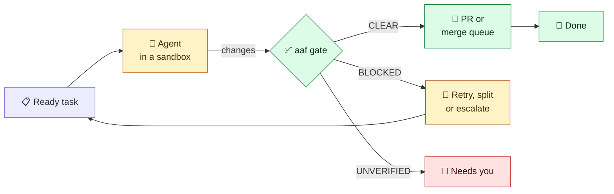

<div align="center">

# 🏭 AutoAgentFactory

**Let AI coding agents work through your task board, safely, while your machine stays usable.**

[](https://github.com/ToanMobile/AutoAgentFactory/actions/workflows/ci.yml)
[](https://github.com/ToanMobile/AutoAgentFactory/releases)
[](LICENSE)


English · [Tiếng Việt](docs/README.vi.md) · [Quickstart](docs/QUICKSTART.md) · [Full guide](docs/GUIDE.md)


<sub>AAF Studio (<code>aaf ui --open</code>), shown with example data</sub>

</div>

---

`aaf` is one Rust CLI (plus a guard hook, `aaf-hook`) that turns
*"let an agent loose on my code"* into a pipeline you can trust:



The agent never decides when it is done. A gate running **outside** the
sandbox does, and only a signed `CLEAR` receipt lets the work through.

## ✨ Why aaf

| 😬 Without aaf | 🛡️ With aaf |
|---|---|
| The agent breaks the build and says "done" | `aaf gate` runs your lint and tests and signs a receipt only when they pass |
| The agent "fixes" a red test by editing the test | Tests, CI and manifests are **head-locked**: changes need your signed approval |
| The agent fakes a green result | Receipts are HMAC-signed with a key the agent cannot read, bound to the exact file tree |
| Five Gradle builds at once freeze the Mac | One **machine-wide queue** for heavy builds that watches memory and CPU |
| The agent force-pushes or deletes `.env` | `aaf-hook` **blocks dangerous tool calls** before they run |
| You lose track of what ran, how long, and what it cost | **Studio** shows every number on one page |

Works with **Claude Code, Codex, Gemini, Antigravity and OpenCode**.

## 🚀 Get started in 3 steps

**1. Install** (macOS / Linux; checks SHA-256, falls back to a source build):

```sh
curl -fsSL https://raw.githubusercontent.com/ToanMobile/AutoAgentFactory/main/scripts/install.sh | sh
```

<details>
<summary>Other ways: Homebrew, Windows, from source</summary>

```sh
brew install --formula packaging/homebrew/aaf.rb          # Homebrew
cargo install --path crates/aaf-cli  --locked             # from source: aaf
cargo install --path crates/aaf-hook --locked             # from source: aaf-hook
```

```powershell
irm https://raw.githubusercontent.com/ToanMobile/AutoAgentFactory/main/scripts/install.ps1 | iex
```

Keep both `aaf` and `aaf-hook` on your `PATH`. Details are in the
[full guide](docs/GUIDE.md#installation).

</details>

**2. Set up your repo:**

```sh
cd ~/code/my-app
aaf setup        # detects your agents, registers hooks, writes config, runs checks
```

Commit the files it registered: `aaf setup` prints the exact `git add … && git commit` line.
Agents work from commits, so an uncommitted hook means no agent run.

**3. Add a task and run the factory:**

```sh
aaf board add --title "Empty state on orders screen" \
  --spec "Show an illustration and a 'Browse products' button when there are no orders." \
  --accept "Empty list shows the empty state"

aaf run --auto   # agent → gate → PR, until you stop it
```

> 💡 If `aaf` cannot detect your test commands, fill in `[commands]` in
> `.autofactory/config.toml`. Until then the gate reports `UNVERIFIED`.

## 📊 Studio: everything on one page

```sh
aaf ui --open    # → http://127.0.0.1:4317/studio
```

No commands to remember. Studio shows:

- **What needs you**: blocked tasks, tasks waiting for review, the factory freeze. Click a card to see the list.
- **KPIs**: tasks done, autonomy, gate first-pass rate, lead time, tokens and cost.
- **Time per stage** (p50 / p90) and **cost per agent**.
- **What is running now**, every task with its acceptance criteria, and **health checks** in one click.

It refreshes every 15 seconds, has a dark mode and works on your phone.
The same report is in the terminal with `aaf report --since 24`.

## 🧰 Everyday commands

| I want to… | Command |
|---|---|
| Set up a repo | `aaf setup` |
| Check the machine and repo | `aaf doctor` |
| Add a task | `aaf board add --title … --spec … --accept …` |
| See the board | `aaf board list` · `aaf board show <id>` |
| Run the agents | `aaf run` (once) · `aaf run --auto` (keep going) |
| Run the checks myself | `aaf gate` |
| See metrics | `aaf ui --open` · `aaf report` · `aaf watch` |
| Unblock a task | `aaf board unblock <id>` |
| Approve a locked change | `aaf approve --reviewer <name>` |
| Run a heavy build politely | `aaf slot -- ./gradlew test` |

Add `--json` to any command for machine-readable output (exit `0` ok, `1` error, `2` blocked).

<details>
<summary>Everything else aaf can do</summary>

| | Feature | Command |
|---|---|---|
| 📋 | Task board with dependencies, splitting and rework | `aaf board` |
| 🛡️ | Guard hook for Claude Code, Codex, Gemini, Antigravity, OpenCode | `aaf-hook` |
| 👥 | Multi-account scheduling with rate-limit cooldowns | `aaf accounts` |
| 📸 | Signed device-screenshot proofs | `aaf proof` |
| 🧭 | Declarative SOP workflows and 10 agent CLIs | `aaf sop` · `aaf executors` |
| 📝 | Acceptance handover report per task | `aaf handover` |
| 📱 | Terminal cockpit and Telegram companion | `aaf cockpit` · `aaf telegram` |
| 🔄 | Self-update and shell completions | `aaf upgrade` · `aaf completions` |

Run `aaf <command> --help`, or see the [command reference](docs/GUIDE.md#command-reference).

</details>

## 📦 Requirements

- **macOS** (agents run inside the Seatbelt sandbox) or **Linux** (no agent sandbox yet, so `aaf run` needs `--unsandboxed`)
- **git ≥ 2.34**
- At least one agent CLI logged in, for example **Claude Code** (`claude`)
- **`gh`** (optional), to open pull requests

## 📚 Documentation

| Doc | What is inside |
|---|---|
| [Quickstart](docs/QUICKSTART.md) | From zero to a first run in 3 minutes |
| [Full guide](docs/GUIDE.md) | Configuration, every command, the safety model, heavy builds, FAQ, exit codes |
| [Architecture](docs/ARCHITECTURE.md) | Crates, modules, the life of a task, dependency rules |
| [Security](SECURITY.md) | Threat model, every guard rule, known gaps |
| [Tiếng Việt](docs/README.vi.md) | Hướng dẫn đầy đủ bằng tiếng Việt |

## 🤝 Contributing

The repo's own gate is the same as CI:

```sh
cargo fmt --all --check
cargo clippy --workspace --all-targets -- -D warnings
cargo test --workspace
```

House rules are in [docs/ARCHITECTURE.md](docs/ARCHITECTURE.md#6-house-rules).

## 📄 License

[Apache-2.0](LICENSE)
