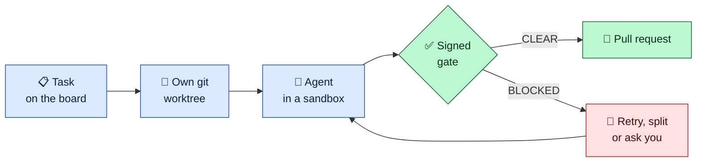

<div align="center">

# AutoAgentFactory

**Let AI coding agents work through your task board, safely, while your machine stays usable.**

[](https://github.com/ToanMobile/AutoAgentFactory/actions/workflows/ci.yml)


English · [Tiếng Việt](docs/README.vi.md) · [Quickstart](docs/QUICKSTART.md) · [Full guide](docs/GUIDE.md)

</div>

---

`aaf` is one Rust binary (plus a small guard, `aaf-hook`) that turns
*"let an agent work on my repo"* into a repeatable pipeline:



## Why use it

| Without aaf | With aaf |
|---|---|
| The agent says "done" but the build is red | Work is accepted only when `aaf gate` writes a **signed receipt** for that exact tree |
| The agent "fixes" a failing test by editing the test | Tests, CI and manifests are **head-locked**: changes need your sign-off |
| Five agents start Gradle at once and the Mac freezes | One **machine-wide queue** for heavy builds that watches memory and CPU |
| The agent force-pushes or deletes `.env` | `aaf-hook` **blocks dangerous tool calls** before they run |
| You lose track of what ran, how long, and what it cost | **Studio** shows every number on one page |

Works with **Claude Code, Codex, Gemini, Antigravity and OpenCode**.

## Get started in 3 steps

```sh
# 1. Install aaf and aaf-hook (macOS / Linux)
curl -fsSL https://raw.githubusercontent.com/ToanMobile/AutoAgentFactory/main/scripts/install.sh | sh

# 2. Set up your repo: detects your agents, registers hooks, writes config, runs checks
cd ~/code/my-app
aaf setup

# 3. Add a task and let the factory run it
aaf board add --title "Empty state on orders screen" \
  --spec "Show an illustration and a 'Browse products' button when there are no orders." \
  --accept "Empty list shows the empty state"
aaf run
```

Then open **Studio** to watch everything:

```sh
aaf ui --open        # → http://127.0.0.1:4317/studio
```

> Requirements: macOS or Linux, git ≥ 2.34, and at least one agent CLI
> (for example `claude`) logged in. `gh` is optional, for pull requests.
> On Linux, agents run without a sandbox for now (`aaf run --unsandboxed`).

## Studio: all your numbers on one page

`http://127.0.0.1:4317/studio` shows, with no commands to remember:

- **KPIs**: tasks done, autonomy, gate first-pass rate, lead time, tokens and cost
- **Time per stage** (p50 / p90) and **cost per agent**
- **What is blocked and why**, and what is **running now**
- **Health checks** with one click (`aaf doctor`)

It refreshes every 15 seconds and works on your phone. The same report is in
the terminal with `aaf report --since 24`.

## Everyday commands

| I want to… | Command |
|---|---|
| Set up a repo | `aaf setup` |
| Check the machine and repo | `aaf doctor` |
| Add a task | `aaf board add --title … --spec … --accept …` |
| See the board | `aaf board list` · `aaf board show <id>` |
| Run the agents | `aaf run` (once) · `aaf run --auto` (keep going) |
| Run the checks myself | `aaf gate` |
| See metrics | `aaf ui --open` · `aaf report` |
| Unblock a task | `aaf board unblock <id>` |
| Approve a locked change | `aaf approve --reviewer <name>` |
| Run a heavy build politely | `aaf slot -- ./gradlew test` |

Add `--json` to any command for machine-readable output
(exit `0` ok, `1` error, `2` blocked).

## Learn more

| Document | What is inside |
|---|---|
| [Quickstart](docs/QUICKSTART.md) | Install options (Homebrew, Docker, Windows, from source) and a first run |
| [Full guide](docs/GUIDE.md) | Every command, the configuration, the safety model, heavy builds, FAQ |
| [Architecture](docs/ARCHITECTURE.md) | Crates, modules, the life of a task, dependency rules |
| [Security](SECURITY.md) | Threat model and every guard rule |
| [Hướng dẫn tiếng Việt](docs/README.vi.md) | Vietnamese guide and verification status |

## Contributing

```sh
cargo fmt --all --check
cargo clippy --workspace --all-targets -- -D warnings
cargo test --workspace
```

These are the same checks CI runs. House rules are in
[docs/ARCHITECTURE.md](docs/ARCHITECTURE.md#6-house-rules).

## License

Apache-2.0. See [LICENSE](LICENSE).
