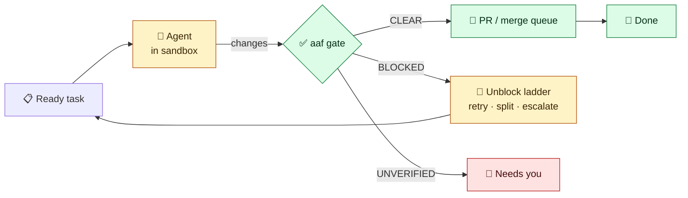

<div align="center">

# 🏭 AutoAgentFactory

**Let AI coding agents work on your repo — safely, verifiably, and without freezing your machine.**

[](https://github.com/ToanMobile/AutoAgentFactory/actions/workflows/ci.yml)
[](https://github.com/ToanMobile/AutoAgentFactory/tags)
[](LICENSE)


English · [Tiếng Việt](docs/README.vi.md) · [Quickstart](docs/QUICKSTART.md) · [Full reference](docs/REFERENCE.md)

</div>

---

`aaf` is one Rust CLI (plus a guard hook, `aaf-hook`) that turns *"let an agent loose on my code"* into a pipeline you can trust:

```text
  📋 task  ─▶  🌳 own worktree  ─▶  🤖 sandboxed agent  ─▶  ✅ signed gate  ─▶  🔀 pull request
```

The agent never decides when it is done. A gate running **outside** the sandbox does — and only a signed `CLEAR` receipt lets the work through.

## ✨ Why aaf

| 😬 Without aaf | 🛡️ With aaf |
|---|---|
| Agent breaks the build and says "done" | `aaf gate` runs your lint + tests and signs a receipt only when they pass |
| Agent "fixes" a red test by editing the test | Tests, CI and manifests are **head-locked** — changes need a signed approval |
| Agent fakes a green result | Receipts are HMAC-signed with a key the agent can't read, bound to the exact file tree |
| Five Gradle builds at once freeze the Mac | One machine-wide queue for heavy builds, aware of memory pressure |
| Agent force-pushes or deletes `.env` | `aaf-hook` blocks dangerous commands before they run |
| Tokens leak into the agent's shell | Agents get an allow-list of env vars, never your whole shell |

## 🔄 How it works



## 🚀 Quick start

**1. Install** (macOS / Linux — verifies SHA-256, falls back to a source build):

```sh
curl -fsSL https://raw.githubusercontent.com/ToanMobile/AutoAgentFactory/main/scripts/install.sh | sh
```

<details>
<summary>Other ways: Homebrew, Windows, from source</summary>

```sh
brew install --formula packaging/homebrew/aaf.rb          # Homebrew
cargo install --path crates/aaf-cli  --locked             # from source: aaf
cargo install --path crates/aaf-hook --locked             # from source: aaf-hook
```

```powershell
irm https://raw.githubusercontent.com/ToanMobile/AutoAgentFactory/main/scripts/install.ps1 | iex
```

Keep both `aaf` and `aaf-hook` on your `PATH`. See [Installation](docs/REFERENCE.md#installation) for details.

</details>

**2. Set up your repo:**

```sh
cd ~/code/my-app
aaf setup                 # detect agents, register hooks, sync skills, run doctor
```

Then commit the files it registered — `aaf setup` prints the exact `git add … && git commit` line. Agents work from commits, so an uncommitted hook means no agent run.

**3. Add a task and run the factory:**

```sh
aaf board add --title "Empty state on orders screen" \
  --spec "Show an illustration and a 'Browse products' button when there are no orders." \
  --accept "Empty list renders the empty state"

aaf run --auto            # agent → gate → PR, until you stop it
aaf watch                 # live dashboard
```

> 💡 If `aaf` can't detect your test commands, fill in `[commands]` in `.autofactory/config.toml` — until then the gate reports `UNVERIFIED`.

## 🧰 What's inside

| | Feature | Command |
|---|---|---|
| 📋 | Task board with dependencies, splitting and rework | `aaf board` |
| 🏭 | Factory loop: worktree → agent → gate → PR | `aaf run` |
| ✅ | Signed gate with head lock and store-compliance scan | `aaf gate` · `aaf approve` |
| 🛡️ | Guard hook for Claude Code, Codex, Gemini, Antigravity, OpenCode | `aaf-hook` |
| 🚦 | Machine-wide queue for Gradle / Xcode / Unity builds | `aaf slot` |
| 👥 | Multi-account scheduling with rate-limit cooldowns | `aaf accounts` |
| 📸 | Signed device-screenshot proofs | `aaf proof` |
| 🧭 | Declarative SOP workflows and 10 agent CLIs | `aaf sop` · `aaf executors` |
| 📊 | Status, live dashboard, reports, handover | `aaf status` · `aaf watch` · `aaf report` |
| 📱 | Web / mobile cockpit and Telegram companion | `aaf ui` · `aaf telegram` |
| 🩺 | Health check and self-update | `aaf doctor` · `aaf upgrade` |

Run `aaf <command> --help` for any command, or see the [command reference](docs/REFERENCE.md#command-reference).

## 📦 Requirements

- **macOS** (agents run inside the Seatbelt sandbox) or **Linux** (no agent sandbox yet — `aaf run` needs `--unsandboxed`)
- **git ≥ 2.34**
- **Claude Code CLI** (`claude`), logged in — or another supported agent CLI
- **`gh`** (optional) — to open pull requests

## 📚 Documentation

| Doc | What's in it |
|---|---|
| [Quickstart](docs/QUICKSTART.md) | From zero to first run in 3 minutes |
| [Full reference](docs/REFERENCE.md) | Configuration, every command, safety model, FAQ, exit codes |
| [Architecture](docs/ARCHITECTURE.md) | How the crates and modules fit together |
| [Tiếng Việt](docs/README.vi.md) | Hướng dẫn đầy đủ bằng tiếng Việt |
| [Security](SECURITY.md) | Threat model and known gaps |

## 🤝 Contributing

The repo's own gate is the same as CI:

```sh
cargo fmt --all --check
cargo clippy --workspace --all-targets -- -D warnings
cargo test --workspace
```

## 📄 License

[Apache-2.0](LICENSE)
