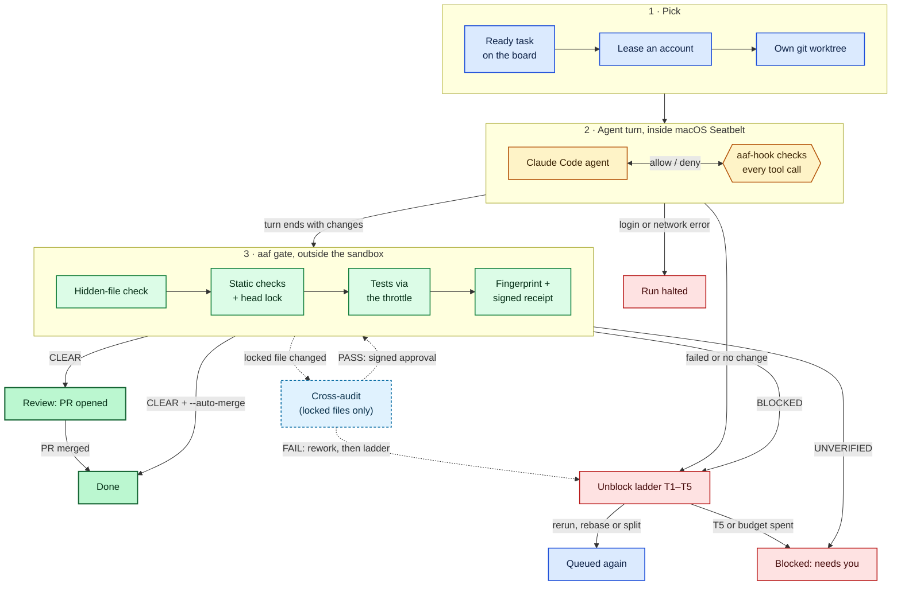
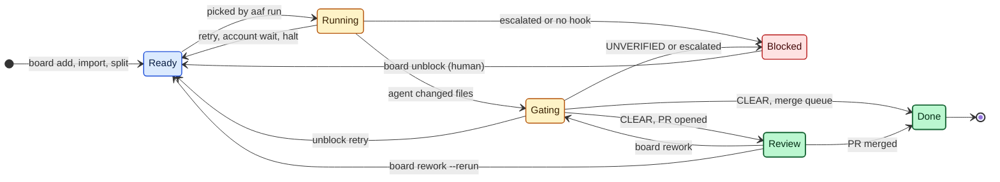
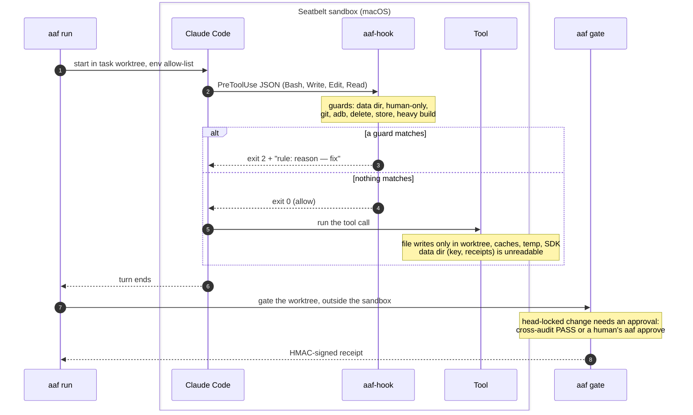
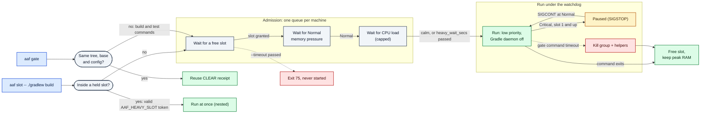

English | [Tiếng Việt](docs/README.vi.md)

# AutoAgentFactory (`aaf`)

**Run Claude Code agents on a task board while your machine stays usable. Agents work inside a sandbox, a signed gate checks what they hand back, and only one heavy build runs at a time.**

`aaf` is a single Rust command-line tool, plus a companion guard binary (`aaf-hook`). Together they turn "let an AI agent work on my repo" into a repeatable pipeline: **task → isolated worktree → sandboxed agent → signed gate → pull request or merge queue**. Every repository on the machine uses the same binary and the same layered configuration.

- **Work you can trust.** A task is accepted only when `aaf gate` writes an HMAC-signed receipt. The receipt is bound to the exact file tree, base commit and gate configuration. It lives outside the repository, where the agent cannot write it.
- **No quiet test tampering.** Tests, CI files, build manifests and agent configuration are *head-locked*. When a change touches them, the gate stays blocked until someone signs off on exactly that change.
- **A machine that keeps responding.** Gradle, Xcode and Unity builds from every repo and every agent share one machine-wide queue. The queue watches memory pressure, CPU load and recorded peak RAM.
- **Guard rails on the agent.** A PreToolUse hook blocks force-pushes, deletion of secrets and keystores, writes to git's control files, device-bricking `adb`/`fastboot` commands, store submissions and "human-only" commands, before they run.
- **Account-aware scheduling.** `aaf` discovers several Claude Code profiles and applies a pinned, sticky or least-used policy. It respects cooldowns after rate limits.

### How aaf works



*Each task gets its own account lease and git worktree. The agent works inside the sandbox while `aaf-hook` judges every tool call; only a signed `CLEAR` receipt from the gate, which runs outside the sandbox, moves the work on to a pull request or the merge queue. Failures climb the unblock ladder. A login failure stops the whole run at once instead of burning attempts; a network failure does the same, after a few backoff retries when the run uses `--auto`.*

> **About the `v3` and `v3.2` tags.** Items marked **`v3`** and **`v3.2`** are built into the binary with unit, CLI, real-git, and macOS `/usr/bin/sandbox-exec` tests. Live Android Gradle, Unity EditMode, Xcode builds inside Seatbelt, and remote GitHub API / `mobile-mcp` runs on external app repositories remain operator-side verification when targeting those repos (see [Project status](#project-status)).

---

## Contents

1. [Why aaf](#why-aaf)
2. [Features at a glance](#features-at-a-glance)
3. [Requirements](#requirements)
4. [Installation](#installation)
5. [Quick start](#quick-start)
6. [How a task flows](#how-a-task-flows)
7. [Configuration reference](#configuration-reference)
8. [Command reference](#command-reference)
9. [How the safety model works](#how-the-safety-model-works)
10. [Heavy builds and machine load](#heavy-builds-and-machine-load)
11. [Multi-repo, team workflow and GitHub](#multi-repo-team-workflow-and-github)
12. [Troubleshooting and FAQ](#troubleshooting-and-faq)
13. [Exit codes](#exit-codes)
14. [Project status](#project-status)
15. [Support, contributing and license](#support-contributing-and-license)

---

## Why aaf

Coding agents are fast. Left alone in a real repository, they also cause the same few problems again and again. `aaf` addresses each one in code:

| The problem | What `aaf` does about it |
|---|---|
| **The agent breaks the build and calls it done.** | The agent does not decide when a task is finished. The factory runs `aaf gate` *outside* the sandbox after the agent's turn. The gate runs your lint, build and test commands. A task reaches a pull request or the merge queue only when the gate is `CLEAR`. |
| **The agent "fixes" a failing test by editing the test.** | Head lock: existing files that match `gate.head_lock_globs` cannot be modified, deleted or renamed without a signed approval for that exact set of changes. The defaults cover test files, CI workflows, `Cargo.toml`, `package.json` and `build.gradle`, and also `.claude/**`, `CLAUDE.md` and `.mcp.json`. |
| **The agent fakes a green result.** | Receipts are signed with a key that the agent cannot read inside the sandbox. A receipt is valid only for the tree fingerprint it was computed on. If the tree changes while the gate runs, the result is `UNVERIFIED`, not `CLEAR`. |
| **Five agents start Gradle at once and the Mac freezes.** | Heavy commands (Gradle, Xcode, Unity batch mode) go through one queue for the whole machine. Commands that are always heavy run alone. Under critical memory pressure, the command in the latest slot is paused with `SIGSTOP` and resumed when pressure returns to normal. |
| **The agent touches secrets or destroys git state.** | `aaf-hook` blocks deleting or overwriting `.env*`, keystores, `google-services.json` and similar files. It also blocks force-pushes, `reset --hard`, `--no-verify` and edits to git hooks and config. The Seatbelt sandbox blocks writes to `aaf`'s data directory and to other tasks' worktrees, and blocks reading the data directory. |
| **Tokens leak into the agent's environment.** | The agent gets an allow-list of environment variables, not your whole shell. Variables with credential-shaped names can be passed only from the machine-wide config file, never from a repository file. |

---

## Features at a glance

| Area | What you get | Where |
|---|---|---|
| **Board and factory** | A SQLite-backed task board (`aaf board`) and a factory loop (`aaf run`). Each task gets its own git worktree and its own agent run. Gate runs are batched, and a failing batch is split in halves until the culprit is found. A five-tier unblocker retries, adds context, splits a task or escalates it to you. | `main` |
| **Sandbox** | Agents started by `aaf run` run inside a generated Seatbelt profile (`/usr/bin/sandbox-exec`) on macOS. On Linux `aaf run` does not wrap agents yet (bwrap integration pending) and needs `--unsandboxed`; the bubblewrap policy builder and container detection ship in `v3.4` but are not wired into `aaf run`. | `main` / **`v3.4`** |
| **Hook guards** | `aaf-hook` is a multi-host guard hook (`--host <auto\|claude\|codex\|gemini\|antigravity\|opencode>`) covering Claude Code `PreToolUse` (`Bash`, `Write`, `Edit`, `MultiEdit`, `Read`), Codex CLI `PreToolUse` (including `apply_patch`), Gemini CLI / Antigravity `BeforeTool`, and OpenCode `PreToolUse` (`v3.4`). It has guards for git, protected files, the data directory, `adb`/`fastboot`, store submission, human-only actions and heavy commands. | `main` / **`v3.4`** |
| **Gate and receipts** | Scoped, full and release modes. Static checks run on added lines. Head lock, App Store / Google Play compliance scan, and HMAC-SHA256 receipts and approvals. | `main` |
| **Throttle and `aaf slot`** | One queue for heavy commands, shared by the gate, agents, git hooks and CI runners on the same machine. | `main` |
| **Accounts** | Discovers Claude Code profiles (`~/.claude`, `~/.claude-*`). Account selection is `pinned`, `sticky` or `least_used`; cooldowns are set by hand or after limits. | `main` |
| **GitHub** | Opens pull requests through your own `gh` login. Can also land changes through a fast-forward-only merge queue. | `main` |
| **GitHub Projects v2 sync and issue import** | `aaf board import-issues` takes issues only from allow-listed authors. `aaf board sync-github` sets Projects v2 `Status` columns, or `status:*` labels as a fallback. | **`v3`** |
| **Proof** | `aaf proof record/verify/show` validates a device screenshot and stores it as an HMAC-signed proof bound to the tree fingerprint. With `[proof].required = true`, `aaf gate` blocks when there is no valid proof. | **`v3`** |
| **Skills** | 15 bundled `SKILL.md` packs, chosen by project profile: `aaf skills list/sync` and `aaf init --with-skills`. | **`v3`** |
| **Observability** | `aaf status` (tasks, runs, tokens, estimated cost, accounts, throttle), the read-only `aaf watch` dashboard and `aaf board trace`. | **`v3`** |
| **Planning and scale-out** | `aaf plan` (read-only planning prompt), `aaf board split`, `aaf run --auto-split` and `--max-parallel auto`. | **`v3`** |
| **Cross-provider cross-audit** | The auditor that reviews head-locked changes can use a different provider or model (`[cross_audit]`). | **`v3`** |
| **Outage handling and rework** | Structured HTTP 5xx/`overloaded` self-healing (`RetryAfter` + jittered backoff) does not burn unblock cycles. `aaf board rework` sends a task in review back. | **`v3` / `v3.2`** |
| **DAG, scopes and 4-stage pipeline** | `aaf board dep`/`graph` with critical-path tie-breaker and `blocked_upstream`, APFS scope-keyed locks (`--scope`), read-only `plan_stage` + `board approve-plan`, `audit_rework:`, `[run].max_open_review` queue brake, verified squash-merge, `aaf gc`, and DB migration `v3 -> v4` (read-only compatible with v3/v4). | **`v3.2`** |
| **7 Golden Standards and handover** | 3-tier monotonic `[cross_audit]`, `G1..G7` + `MechanicalScore` with non-deadlocking solo-dev badge, post-gate HMAC `"audit\0"` verdicts, `aaf handover` (read-only Markdown/CSP HTML/JSON, verified PNG `<= 4 MiB`), and sanitized PR body (`< 60 KB`). | **`v3.2`** |
| **Live streams, snapshots and TTY cockpit** | Sanitized `2 MiB` live stream logs (`streams/<run_id>.jsonl`), protected pre-turn snapshots (`refs/aaf/snapshots/*` + `turn_snapshots`), `board undo`/`steer`, and synchronous interactive TTY `aaf cockpit` (0 ports, 0 new crates, ANSI/OSC sanitized). | **`v3.2`** |
| **Remote Telegram companion (`aaf telegram`)** | Zero-port outbound Telegram Bot API long-polling (Tier-1 config only, fail-closed `allowed_chat_ids`, env-only token) for read-only `/status`, `/board`, `/show`, `/handover` and opt-in two-step `/confirm <code>` approvals/mutations. | **`v3.4`** |
| **Multi-host hook adapters** | `aaf-hook --host <auto\|claude\|codex\|gemini\|antigravity\|opencode>` and `aaf init --hook-host <claude\|codex\|gemini\|antigravity\|opencode\|all>` (`all` = claude, codex, gemini, opencode; `--hook-host antigravity` replaces the gemini entry in `.gemini/settings.json` and covers Gemini tools too) extend the full guard suite to Codex CLI (including `apply_patch` path checks), Gemini CLI / Antigravity (`BeforeTool`), and OpenCode (`PreToolUse`). | **`v3.4`** |
| **Packaging, `[secret NAME]` masking & Linux `bwrap`** | Streaming chunk-boundary `[secret NAME]` masking, GitHub Release workflow + SHA-256 verified `scripts/install.sh` + Homebrew formula + hardened Docker runner, and the Linux bubblewrap (`bwrap`) policy builder / container detection (not yet used by `aaf run`; Linux needs `--unsandboxed`). | **`v3.4`** |
| **Declarative SOP workflows (`aaf sop`)** | TOML SOP pipelines (`Agent`, `Script`, `Gate`, `HumanGate`) with DAG validation, bounded `on_fail_goto` rework edges, 5 built-in blueprints (`backend`, `frontend`, `mobile-android`, `unity-game`, `bugfix`), and crash-safe checkpoint resume (`approve`, `send-back`). | **`v3.5`** |
| **10-CLI executor registry, roles & MCP audit (`aaf executors`)** | Unified descriptors and PATH inventory for 10 coding CLIs (`claude`, `codex`, `gemini`, `opencode`, `cursor`, `antigravity`, `codebuddy`, `kimi`, `pi`, `deepseek`), ordered fallback routing with audit trail, `.autofactory/roles/*.toml`, and read-only `.mcp.json` inline-secret scanning. | **`v3.5`** |
| **Web & Mobile Cockpit (`aaf ui`)** | Zero-dependency embedded warm-paper/dark SPA over `std::net::TcpListener` + SSE live stream, Needs Review approval inbox, scannable terminal QR pairing (`#token=` fragment), strict CSP, Bearer auth, Origin/Host CSRF protection, and fail-closed LAN bind enforcement. | **`v3.5`** |
| **Cross-OS self-updater & onboarding (`aaf upgrade`, `aaf completions`)** | Fail-closed SHA-256 self-updater across 5 targets (macOS/Linux/Windows), Windows PowerShell `scripts/install.ps1`, shell completions (`bash`/`zsh`/`fish`/`powershell`), and [`docs/QUICKSTART.md`](docs/QUICKSTART.md). | **`v3.5`** |

---

## Requirements

| Requirement | Notes |
|---|---|
| **macOS** | The agent sandbox uses Seatbelt (`/usr/bin/sandbox-exec`), including narrow per-UID `/Volumes/<Vol>/.TemporaryItems/folders.<uid>` allowance for Unity on secondary volumes. |
| **Linux** | `aaf run` has no agent sandbox yet (bwrap integration pending): it refuses (exit 2) until you pass `--unsandboxed`, even when bubblewrap (`bwrap`) or a hardened container (`packaging/docker/`) is present. `aaf doctor` reports a detected `bwrap`/container as information only. Real Linux `/proc` load behavior remains operator-verified on Linux hosts. |
| **Rust toolchain** | The workspace declares `rust-version = "1.89"`. The repository pins its toolchain in `rust-toolchain.toml` (channel `1.100.0`, with `clippy` and `rustfmt`), and rustup uses that pinned toolchain inside the checkout. |
| **git ≥ 2.34** | Required. `aaf doctor` fails its `git` check below 2.34, because the tree fingerprint uses `git add --sparse`. |
| **Claude Code CLI (`claude`)** | Must be on `PATH` and logged in. This is the default executor of `aaf run`. `aaf doctor` warns when `claude` is missing. |
| **`gh` (optional)** | Used to open pull requests, and in `v3` for issue import and Projects v2 sync. Without `gh` or a GitHub remote, a finished task waits in Review on its branch, with its receipt, and no PR is opened. |

---

## Installation

`aaf` ships with packaged install options (**`v3.4`**) alongside building from source:

- **POSIX installer (`scripts/install.sh`):** downloads SHA-256 verified release tarballs published by `.github/workflows/release.yml` (macOS and Linux, `arm64` and `x86_64`), or builds locally with `--from-source`:

  ```sh
  sh scripts/install.sh                      # latest GitHub release -> ~/.local/bin
  sh scripts/install.sh --version v0.1.0     # pin a release tag
  sh scripts/install.sh --from-source        # build from local checkout via cargo
  ```

- **Homebrew (`packaging/homebrew/aaf.rb`):** formula installing both `aaf` and `aaf-hook` for macOS and Linux.
- **Docker (`packaging/docker/`):** multi-stage hardened Linux runner image (`Dockerfile` + `docker-compose.yml`, non-root user with `bubblewrap`).
- **Build from source:**

```sh
git clone https://github.com/ToanMobile/AutoAgentFactory.git
cd AutoAgentFactory

# Option A: install both binaries into ~/.cargo/bin (recommended)
cargo install --path crates/aaf-cli  --locked   # installs `aaf`
cargo install --path crates/aaf-hook --locked   # installs `aaf-hook`

# Option B: build only
cargo build --release -p aaf-cli -p aaf-hook
# -> target/release/aaf and target/release/aaf-hook
```

Make sure **both binaries are on your `PATH`**, and invoke `aaf` by its bare name:

- When `aaf init` finds `aaf-hook` on `PATH`, it registers the hook by its **bare name**. That form works on other machines and inside task worktrees. Only when the hook is missing from `PATH` but sits next to the `aaf` binary does `init` write an absolute path. If that path points into `target/release/`, a `cargo clean` deletes the hook, and `aaf doctor` then reports `hook_binary` as FAIL.
- When the hook blocks a heavy build, it tells the agent to run `aaf slot -- <command>`. The hook only trusts a command word that is exactly `aaf`: `./aaf` and `/path/to/aaf` do not count.

Check the machine:

```sh
aaf doctor          # outside a git repo this is the machine doctor; repo checks show "n/a"
```

---

## Quick start

From zero to your first agent run in one repository:

**1. Initialise the repository.**

```sh
cd ~/code/my-app
aaf init
```

`aaf init` does four things:

- detects the stack;
- writes `.autofactory/config.toml` (tier 2);
- merges an `aaf-hook` entry into `.claude/settings.json`, keeping your other hooks;
- adds `.autofactory/config.local.toml` to `.gitignore`.

Running `aaf init` again is safe: an existing config is kept unless you pass `--force`.

**2. Check the gate commands.** `aaf init` fills in `[commands]` only when it is sure of the stack:

- Android with `gradlew` and no product flavors;
- Rust;
- Go;
- Unity with a known editor version and an EditMode test assembly;
- **`v3`:** Flutter, only when `pubspec.yaml` has `sdk: flutter` and the repository has a `test/` folder.

For any other stack the test commands stay empty, and the gate reports `UNVERIFIED` until you set them. Open `.autofactory/config.toml` and fill in at least:

```toml
[commands]
test_scoped = "npm test -- --onlyChanged"   # your fast tests, used by `aaf gate` (scoped)
test_full   = "npm test"                    # whole suite, used by --full and --release
lint        = "npm run lint"
```

**3. Commit the registration.** Agents work in worktrees cut from a commit. If the hook registration is not committed, `aaf run` does not start the agent. `aaf init` prints the exact command when a commit is needed:

```sh
git add .claude/settings.json .autofactory/config.toml .gitignore && git commit -m "chore: aaf init"
```

**4. Run the doctor inside the repo.**

```sh
aaf doctor          # exit 2 if a required check fails (git, config, hook_registered, hook_binary, executor_hooks, data_dir, receipt_key)
```

**5. Run the gate yourself once.**

```sh
aaf gate            # lint + test_scoped; prints CLEAR, BLOCKED or UNVERIFIED and the receipt path
```

**6. Add a task.**

```sh
aaf board add \
  --title "Show an empty state on the orders screen" \
  --spec  "When the user has no orders, show the empty-state illustration and a 'Browse products' button." \
  --accept "Empty list renders the empty state" \
  --accept "Tapping the button opens the catalogue" \
  --priority P1
```

A task needs at least one `--accept` criterion. Its spec is never edited after the task exists.

**7. Run the factory.**

```sh
aaf run                     # one pass over Ready tasks
aaf run --auto              # keep polling for Ready tasks until interrupted or frozen
```

Each task goes through a worktree, a sandboxed agent, the gate and then a pull request. The task then waits in **Review**. Use `aaf board list` and `aaf board show <id>` to see where every task is and why.

**8. Review and approve.** If a task changed a head-locked file and the automatic cross-audit did not clear it, the gate stays `BLOCKED`. Review the change, then sign the approval yourself from a terminal:

```sh
aaf approve --reviewer "your-name"
```

When a task ends up Blocked, read `aaf board show <id>`, fix the cause, and put it back with `aaf board unblock <id>`.

---

## How a task flows

Task states: `backlog`, `ready`, `running`, `gating`, `review`, `blocked`, `done`, `cancelled`.



*The moves the factory and the `aaf board` commands make. New tasks start in Ready; `aaf board unblock` and `aaf board rework` are the human's way back in. The domain also defines `backlog` and `cancelled`, and `aaf status` counts them, but no command on `main` moves a task into either state yet.*

1. **Ready to Running.** `aaf run` picks Ready tasks by priority (P0 is most urgent), and only tasks whose `--blocked-by` dependencies are Done. Each task gets its own worktree under `AAF_WORKTREE_DIR` (default `~/.cache/autofactory/worktrees`), and an account chosen by your selection policy.
2. **Agent.** Before starting a code-writing agent, `aaf` checks that the matching host hook registration is committed on the base branch and valid in the worktree (`.claude/settings.json` for `claude`; `.codex/hooks.json`, `.gemini/settings.json`, or `.opencode/hooks.json` for built-in `codex`/`gemini`/`antigravity`/`opencode` writers when `executor_cmd` is empty; read-only stages such as auditors are not enforced by `aaf run` yet). It then starts the agent inside the sandbox, with the allow-listed environment.
3. **Gating.** When the agent's turn ends, the task moves to the gate queue. Waiting there does not hold an account. Tasks waiting together are merged into one integration tree and gated once. A red batch is split in halves until the failing task is alone.
4. **Cross-audit.** If a task changed head-locked files, a second agent run in a fresh context answers a fixed yes/no checklist about the diff. The checklist covers test-only branches in production code, values hard-coded to pass tests, leaked secrets, removed assertions, CI changes, stubs and acceptance criteria. Only a clean PASS becomes a signed approval for that change. The auditor runs in a clean worktree of the base, not the author's worktree.
5. **Review or Done.** By default a `CLEAR` task gets a pull request that carries its gate receipt, and moves to **Review**. With `--auto-merge`, it goes through the merge queue instead. The queue takes one merge at a time, rebases onto the base, runs the gate again on the rebased tree and fast-forwards, never forcing. The task then becomes **Done**.
6. **Unblocker.** Every failure goes up a ladder:
   - **T1** classifies the failure.
   - **T2** applies mechanical fixes: cooldown and account switch, or a wait, for quota; up to two reruns for flaky failures, stopping at the first rerun that passes; rebase and re-gate for conflicts.
   - **T3** retries with a fresh context and a failure summary.
   - **T4** splits the task into subtasks at depth 1, sharing the root's budget.
   - **T5** moves the task to Blocked for a human, and sends a webhook if you configured one.

   Budgets are set in `[unblocker]`. After `global_freeze_consecutive_fails` failed roots in a row, the whole factory **freezes** until you run `aaf board unfreeze`.
7. **Halted runs.** If the agent CLI fails because of its login or the network, the task goes back to Ready and is not counted as an attempt. `aaf run` stops with `status: "halted"` (exit 2); with `--auto`, a network failure is first retried a few times with backoff. Log in again, or fix the network, and run `aaf run` again.

---

## Configuration reference

### Three tiers

| Tier | File | Committed? | What it may contain |
|---|---|---|---|
| **1: machine** | `~/.config/autofactory/config.toml` (directory overridable with `AAF_CONFIG_DIR`) | No (outside every repo) | `[machine]`, `[accounts]`, `[safety]`, `[notifications]`, `[run]` with `env_pass` only; `v3`: `[cross_audit]` defaults |
| **2: repository** | `.autofactory/config.toml` | **Yes** | `[project]`, `[commands]`, `[gate]`, `[unblocker]`, `[run]`; `v3`: `[cross_audit]`, `[proof]`, `[github]`, `[github.columns]` |
| **3: local** | `.autofactory/config.local.toml` | No (gitignored by `aaf init`) | Can only *tighten* the gate, plus a few personal run settings (below) |

**Precedence:** tier 1 < tier 2 < tier 3 < `AAF_*` environment < command-line flags.

Tiers above 2 can only make the result safer. The rules:

- **`[gate]`, tighten only.** Tiers above 2 can only add `head_lock_globs`, raise `store_compliance` (`off < auto < always`) or raise `min_android_target_sdk`. Changing `command_timeout_secs` is allowed. `base_ref` is ignored, with a warning.
- **Tier 2 only.** `[commands]`, `project.profile`, `run.executor` and `run.executor_cmd` are read from tier 2 only. Set in a higher tier, they are ignored with a warning.
- **`run.env_pass`** is read from tiers 1 and 2 only. In tier 3 it is ignored, with a warning.
- **`run.auto_merge`** can always be switched off. It can be switched *on* only in tier 2 or with the `--auto-merge` flag.
- **Taken from the highest tier.** `run.model`, `run.effort`, `run.max_parallel` and `run.run_timeout_secs`.
- **Unknown keys** in any tier are a load error (exit 1). Sections that do not belong in tier 3 (`[commands]`, `[unblocker]`, `[safety]`, `[accounts]`, `[notifications]`, and in `v3` `[proof]`, `[github]`) are ignored there, with a warning.
- **Where warnings appear.** `aaf doctor` (`config` check) and `aaf gate` print the warnings for every value that was dropped.

### Tier 1: machine config

```toml
# ~/.config/autofactory/config.toml

[machine]
max_heavy_parallel = 0     # heavy commands at once; 0 = a quarter of the CPUs, at least 1
max_load_percent   = 150   # wait while the 1-min load average is above this % of CPU count; 0 disables
max_cpu_percent    = 85    # ...and real CPU busy % is at least this; 0 = load average alone decides
heavy_wait_secs    = 1800  # longest wait for CPU load; after it the command runs anyway, at low priority
low_priority       = true  # run heavy commands at low CPU and I/O priority

[accounts]
selection = "pinned"                           # pinned (default) | sticky | least_used
discovery_globs = ["~/.claude", "~/.claude-*"] # default
max_concurrent_per_account = 1                 # default

[accounts.aliases]
"~/.claude-work" = "work"                      # display name for a config dir; never changes an account id

[safety]
owner_github_allowlist = ["your-github-login"] # whose GitHub issues may become tasks; empty = nobody

[notifications]
webhook_url = ""                               # generic JSON POST target; empty disables it

[run]
env_pass = ["NPM_TOKEN"]                       # extra env vars for agents of every repo (see below)
```

**Account selection** (`[accounts] selection`):

- **`pinned`** (default): each repository is bound to one account.
  - The account comes from the `account` key in the repo's `.claude/settings.local.json` (an id, or a name including `aliases`).
  - Without that key, it is the account the repo used last.
  - For a repo that has never run, it is the least-used free account, which is then kept.
  - While the bound account is in cooldown or busy, the task **waits**. `aaf run` prints which account it is waiting for and until when.
- **`sticky`**: a task and its repo keep their account. When that account hits a limit or is busy, they move to a free account and keep the new one.
- **`least_used`**: every job takes the free account with the fewest tokens in the last 5 hours.

### Tier 2: repository config

`aaf init` writes this file with comments. These are the defaults it writes:

```toml
# .autofactory/config.toml (commit this file)

[project]
name = "my-app"
profile = "auto"            # auto, android, ios, flutter, react-native, expo, web, backend, rust or unity

[commands]                  # run with `sh -c` at the repo root
build = ""
test_scoped = ""            # fast tests for `aaf gate --scoped`
test_full = ""              # whole suite for `aaf gate --full` and `--release`
lint = ""
repro = ""                  # in the schema, but nothing runs it yet

[gate]
base_ref = "auto"           # auto = origin/HEAD, origin/main, origin/master, main, master (first that exists)
# head_lock_globs = [...]   # aaf init writes the full default list here (shown below)
store_compliance = "auto"   # off | auto (scan when the profile ships to a store) | always
min_android_target_sdk = 36
command_timeout_secs = 1800 # per gate command; the process group is killed when it expires
# Red->green & vacuity oracle: off, warn, or block (recommended: block).
# In block mode, proven red->green runs are re-run to catch flaky tests and
# verified against a base control pass; compile-red on add-only new modules is
# blocked (wire into a base entry point); skipped runs record `note: oracle skipped (...)`.
red_green_oracle = "off"

[unblocker]
max_unblock_cycles = 5
max_subtask_depth = 1
max_token_budget = 500000
max_wall_clock_secs = 3600
global_freeze_consecutive_fails = 3

[run]
executor = "claude"         # claude, codex, antigravity, opencode or custom
executor_cmd = []           # command template for non-Claude executors; {prompt} is substituted
auto_merge = false          # false = open a PR with the gate receipt; true = merge when the gate is Clear
max_parallel = 1
run_timeout_secs = 3600
model = ""                  # Claude only: `claude --model`; empty = the CLI's own default
effort = ""                 # Claude only: `claude --effort`; empty = the CLI's own default
env_pass = []               # extra environment variables for this repo's agents
```

The default `head_lock_globs` list in full:

```text
**/*_test.*   **/*.test.*   **/*.spec.*   **/test_*.py   **/*Test.kt   **/*Test.java
**/*Tests.swift   **/*Tests.cs   **/tests/**   **/test/**   **/__tests__/**   **/androidTest/**
**/jest.config.*   **/vitest.config.*   **/pytest.ini   **/conftest.py   .github/workflows/**
.autofactory/config.toml   **/Cargo.toml   **/package.json   **/build.rs   **/build.gradle
**/build.gradle.kts   **/.claude/**   **/CLAUDE.md   **/.mcp.json
```

In **`v3`**, the defaults also include `**/.adb-denylist`, `**/.adb-allowlist`, `**/.agents/**` and `**/AGENTS.md`.

### Tier 3: local overrides

```toml
# .autofactory/config.local.toml (gitignored)

[gate]
head_lock_globs = ["docs/api/**"]  # added to the repo list
store_compliance = "always"        # may only be raised

[run]
model = "your-preferred-model"     # personal choice; taken as given
max_parallel = 2
```

### `env_pass`: what reaches the agent

Agents do **not** inherit the environment of the shell that ran `aaf run`. They receive an allow-list:

- `PATH`, `HOME`, `USER`, `LOGNAME`, `SHELL`, `LANG`, `LC_*`, `TERM`, `TMPDIR`;
- toolchain homes: `JAVA_HOME`, `ANDROID_HOME`, `ANDROID_SDK_ROOT`, `GRADLE_USER_HOME`, `CARGO_HOME`, `RUSTUP_HOME`, `UNITY_PATH`, `DEVELOPER_DIR`;
- proxy and certificate variables: `HTTPS_PROXY`, `HTTP_PROXY`, `NO_PROXY` and their lowercase forms, `NODE_EXTRA_CA_CERTS`, `SSL_CERT_FILE`, `SSL_CERT_DIR`;
- `AAF_RUN_ID`, `CLAUDE_CONFIG_DIR` and `AAF_DATA_DIR`, which `aaf` sets itself.

Variables such as `GITHUB_TOKEN`, `GH_TOKEN`, `ANTHROPIC_API_KEY` and `CLAUDE_CODE_*` do **not** reach the agent. This filtering applies even with `--unsandboxed`.

To pass more variables, name them in `[run] env_pass`. The tier 1 and tier 2 lists are added together. Some names have restrictions:

| Name | Tier 1 (machine) | Tier 2 (repo) |
|---|---|---|
| Credential-shaped names (`*_TOKEN`, `*_KEY`, `*_SECRET`, `*PASSWORD*`) and `NODE_OPTIONS` | allowed | **refused** |
| `AAF_*`, `PATH`, `HOME`, git-redirecting `GIT_*` (e.g. `GIT_DIR`, `GIT_CONFIG*`, `GIT_SSH*`), `DYLD_*`, `LD_*`, `BASH_ENV`, `ZDOTDIR`, code-loading variables (`JAVA_TOOL_OPTIONS`, `PYTHONPATH`, `PERL5OPT`, `RUBYOPT`, `NODE_PATH`, …) | **refused** | **refused** |
| `GRADLE_OPTS`, `JAVA_OPTS` | allowed | allowed |

A refused name stops `aaf run` before it takes any task, and the error names the entry. A proxy URL that contains a login (`user:password@`) is withheld unless `env_pass` names that variable. The full list is in `SECURITY.md` §5.

### Environment variables

| Variable | Effect |
|---|---|
| `AAF_DATA_DIR` | Data directory, default `~/.local/share/autofactory`. Holds receipts, approvals, the signing key, the task database and throttle state. |
| `AAF_CONFIG_DIR` | Directory of the tier 1 `config.toml`, default `~/.config/autofactory`. |
| `AAF_WORKTREE_DIR` | Where task worktrees are created, default `~/.cache/autofactory/worktrees`. |
| `AAF_STORE_COMPLIANCE` | Raises `gate.store_compliance`. |
| `AAF_MIN_ANDROID_TARGET_SDK` | Raises `gate.min_android_target_sdk`. |
| `AAF_MAX_PARALLEL` | Overrides `run.max_parallel`. |
| `AAF_AUTO_MERGE` | Can only switch auto-merge **off**. |
| `AAF_RUN_ID`, `AAF_HEAVY_SLOT` | Set by `aaf` itself. Do not set them by hand: the hook blocks agents that try. |

`AAF_COMMANDS_*` variables are deliberately not supported. If they are set, `aaf` warns that they had no effect.

### `v3` and `v3.2` sections

```toml
# .autofactory/config.toml (v3 / v3.2)

[run]
max_open_review = 0            # v3.2: 0 = unlimited; > 0 pauses new dispatches when open review tasks hit the cap

[pipeline]                     # v3.2: 4-stage pipeline (tier 2)
plan_stage = false             # true = run a strictly read-only planning turn before implementation
require_plan_approval = false  # true = pause after plan_stage until `aaf board approve-plan <id>`
max_audit_rework_cycles = 2    # bounded `audit_rework:` loop before human escalation
max_pr_rework_rounds = 2       # bounded PR feedback loop from failing CI / owner review threads (max 3; 0 = off; tier 1/2 only)

[cross_audit]                  # also allowed in tier 1 as machine-wide defaults
executor = ""                  # empty = reuse [run].executor; claude, codex, gemini, opencode or custom
executor_cmd = ""              # command template when executor is custom
model = ""
effort = ""
require_different_provider = false  # true = refuse to run when the auditor would use the author's provider
audit_scope = "head_lock"           # v3.2: head_lock < large < always (monotonic across tiers)
score_gate = false                  # v3.2: bool (false -> true, tighten-only across tiers)
min_average_score = 95              # v3.2: 7 Golden Standards (G1..G7) average floor (tighten-only)
min_criterion_score = 90            # v3.2: per-criterion floor across G1..G7 (tighten-only)

[proof]
required = false               # true = `aaf gate` blocks without a valid signed proof for the current tree
min_bytes = 8192
min_width = 100
min_height = 100
denylist_file = ".adb-denylist"
allowed_tools = ["mobile-mcp:mobile_save_screenshot"]

[github]
enabled = false
repo = ""
project_owner = ""
# project_number = 1           # set it to sync a Projects v2 Status field instead of issue labels
label_filter = ""

[github.columns]               # task state -> board column
backlog = "Backlog"
ready = "Ready"
running = "Building"
gating = "QA"
review = "Review"
blocked = "Blocked"
done = "Done"
cancelled = "Done"
```

How `[cross_audit]` merges:

- Non-empty tier 2 values win over the tier 1 defaults.
- `require_different_provider` is OR-ed across tiers.
- Tier 3 can only tighten `[cross_audit]`: raise `require_different_provider` (`false -> true`), `audit_scope` (`head_lock < large < always`), `score_gate` (`false -> true`), `min_average_score`, and `min_criterion_score`. Any attempt to loosen them is ignored with a warning.
- Under single-account solo-dev runs where `require_different_provider = false`, `MechanicalScore` runs alongside the 7 Golden Standards (`G1..G7`) and surfaces the non-deadlocking badge `same_account — chưa có auditor độc lập`; post-gate verdicts are HMAC-signed with the dedicated `"audit\0"` domain tag.

---

## Command reference

**Global flag `--json`.** stdout carries exactly one JSON object, `{ok, command, status, …, duration_ms}`. Progress lines always go to stderr. The one exception is `aaf slot`, which refuses `--json` because its stdout belongs to the command it runs.

| Command | Purpose | Useful flags |
|---|---|---|
| `aaf init` | Detect the stack, write tier 2 config, register the hook, update `.gitignore` | `--force`; **`v3`**: `--with-skills`, `--host <claude\|agents\|all>`; **`v3.4`**: `--hook-host <claude\|codex\|gemini\|antigravity\|opencode\|all>` (`all` = claude, codex, gemini, opencode; `antigravity` replaces the gemini entry in `.gemini/settings.json` and covers Gemini tools) |
| `aaf doctor` | Read-only check of the machine and the repo | — |
| `aaf gate` | Run the gate and write a signed receipt | `--scoped` (default), `--full`, `--release` (pick one) |
| `aaf approve` | Sign an approval for the current head-lock fingerprint (**human only**) | `--reviewer <name>` (required) |
| `aaf slot -- <cmd> [args…]` | Run any command through the machine-wide heavy queue | `--label <NAME>`, `--timeout <SECS>` |
| `aaf accounts list` / `next` / `cooldown <ID>` | Show accounts, show the next account, set or clear a cooldown | `cooldown`: `--until <unix-seconds>`, `--clear` (default cooldown is 5 hours) |
| `aaf board add` | Add a Ready task for the current repo | `--title`, `--spec`, `--accept` (repeatable, required), `--priority P0..P3` (default P2), `--blocked-by <id>` (repeatable), **`v3.2`** `--scope <prefix>` (repeatable) |
| `aaf board list` | List tasks, most urgent first | `--state <state>`, `--all` (every repo) |
| `aaf board show <ID>` | One task with its dependencies, runs and latest events | — |
| `aaf board unblock <ID>` | Put a Blocked task back to Ready with a fresh budget (**human only**) | — |
| `aaf board unfreeze` | Clear the factory freeze and the failure counter (**human only**) | — |
| `aaf run` | Run Ready tasks through agent, gate and merge point | `--auto`, `--auto-merge`, `--max-parallel <N>`, `--unsandboxed`; **`v3`**: `--max-parallel auto`, `--auto-split` |
| **`v3`** `aaf board rework <ID>` | Send a task in Review back to Gating, or to Ready with `--rerun` | `--reason "…"` (alias `--note`), `--rerun` |
| **`v3`** `aaf board trace <ID>` | Chronological runs and events, with tokens, wall-clock and estimated cost | `--limit <N>` (default 100) |
| **`v3`** `aaf board split <ID>` | Split a Ready or Backlog root task into 2–4 subtasks with disjoint owned paths | `--max <2..4>` (default 4), `--dry-run`, `--unsandboxed` |
| **`v3`** `aaf board import-issues` | Import open GitHub issues written by allow-listed logins | `--label <L>`, `--dry-run` |
| **`v3`** `aaf board sync-github` | Map board states to Projects v2 Status columns or `status:*` labels | `--dry-run` |
| **`v3`** `aaf status` | Read-only overview: task counts, blocked reasons, runs, tokens, estimated cost, accounts, throttle | `--all` |
| **`v3`** `aaf watch` | Live read-only terminal dashboard | `--repo <path>`, `--all`, `--interval <SECS>` (default 2), `--once` |
| **`v3`** `aaf plan "<goal>"` | Build a read-only planning prompt (no agent is launched) | `--file <path>` (repeatable), `--dry-run` |
| **`v3`** `aaf proof record` / `verify` / `show` | Record, verify or print a signed device-screenshot proof | `record`: `--image`, `--device`, `--tool` (default `mobile-mcp:mobile_save_screenshot`), `--task-id`; `verify`/`show`: `--tree-fp` |
| **`v3`** `aaf skills list` / `sync` | List or sync the bundled skill pack | `list`: `--profile`; `sync`: `--host`, `--dir`, `--profile`, `--all`, `--only` (repeatable), `--force` |
| **`v3.2`** `aaf board dep add\|rm` | Add (cycle-checked) or remove a DAG dependency edge | `<task> --blocked-by <blocker>` |
| **`v3.2`** `aaf board graph` | Show topological order, critical path, and cascade-blocked tasks | `--all` |
| **`v3.2`** `aaf board approve-plan <ID>` | Approve a `plan_stage` plan and move the task back to Ready (**human only**) | — |
| **`v3.2`** `aaf board undo <ID>` | Roll back a task worktree to its latest verified `refs/aaf/snapshots/*` commit (**human only**) | `--dry-run` |
| **`v3.2`** `aaf board steer <ID>` | Append a sanitized `steer:` note without editing `ImmutableSpec` (**human only**) | `--note "…"` |
| **`v3.2`** `aaf gc` | Clean orphaned worktrees, finished task refs/snapshots, and expired streams/reports | `--dry-run` |
| **`v3.2`** `aaf handover <ID>` | Read-only acceptance handover report (`md`, CSP `html` with verified PNG `<= 4 MiB`, or `json`) | `--format <md\|html\|json>`, `--out <path>`, `--open` (TTY + macOS) |
| **`v3.2`** `aaf cockpit` | Synchronous interactive TTY cockpit (0 ports, 0 new crates, ANSI/OSC sanitized, **human TTY only**) | `--repo <path>`, `--all` |
| **`v3.4`** `aaf telegram` | Zero-port outbound Telegram companion for status, handover, and opt-in two-step `/confirm` approvals (**human only**) | `--once`, `--all`, `--repo <path>`, `--send-test` |
| `aaf notify` | Push "needs you" moments (factory frozen, factory halted, task blocked, ready for review) or a one-shot `--message` to webhook / Telegram (**human only**) | `--once`, `--all`, `--repo <path>`, `--interval <s>`, `--dry-run`, `--message <text>` |
| **`v3.5`** `aaf sop` | Declarative TOML SOP workflows (list, show, init, validate, runs, run/resume, approve, send-back) | `list`, `show`, `init`, `validate`, `runs`, `run`, `approve`, `send-back` |
| **`v3.5`** `aaf executors` | 10-CLI inventory, fallback resolution preview, reusable role profiles, and read-only `.mcp.json` secret audit | `list`, `resolve`, `roles`, `mcp` |
| **`v3.5`** `aaf ui` | Zero-dependency authenticated local/LAN Web & Mobile Cockpit with SSE live stream and QR pairing, plus the `/studio` metrics page (default `http://127.0.0.1:4317/studio`) (**human only**) | `--host`, `--port`, `--key`, `--read-only`, `--qr`, `--open`, `--all` |
| `aaf report` | Period report: tasks done, lead time, time per lifecycle stage (p50/p90), cost per executor, blocked reasons, autonomy | `--since <hours>`, `--all` |
| **`v3.5`** `aaf upgrade` / `completions` | SHA-256 verified self-updater (**human only**) and shell completions (`bash`, `zsh`, `fish`, `powershell`) | `upgrade`: `--check`, `--version`, `--dry-run`; `completions <shell>` |

`aaf-hook` is not a command you type. Your coding-agent host runs it (with optional `--host <auto|claude|codex|gemini|antigravity|opencode>`, defaulting to `auto`): it reads the Claude Code / Codex CLI / OpenCode `PreToolUse` or Gemini CLI / Antigravity `BeforeTool` JSON payload on stdin and exits `0` to allow or `2` to block. A block message has the form `<rule>: <reason> — fix: <action>`.

### `aaf gate`

The gate takes these steps, in order:

1. **Hidden files.** Any tracked file marked `skip-worktree` or `assume-unchanged` makes the gate `BLOCKED` in every mode.
2. **Change set** against the base. Uncommitted changes and untracked files count.
3. **Static checks** on added lines, skipping binaries, lockfiles and generated folders:

   | Rule | Catches | Severity |
   |---|---|---|
   | `SEC-001` | Private keys and well-known token prefixes | Critical |
   | `SEC-002` | Password or token assigned as a string | Warning |
   | `LAZY-001` | Placeholder and "not implemented" stubs | Critical |
   | `ERR-001` | Swallowed errors | Critical |
   | `LOG-001` | Raw console or stdout logging outside tests | Warning |

   To silence one rule on one line, write an inline marker `aaf:allow(<RULE-ID>) <reason>`. Silenced findings are counted in the receipt.
4. **Head lock.** If locked files were modified, deleted or renamed and there is no valid approval for that exact change set (`lock_fp`), the result is `BLOCKED`.
5. **Store compliance** for Android, iOS, Flutter, React Native and Expo projects (rules `AND-00x`/`AND-10x` and `IOS-00x`/`IOS-10x`). A Critical finding blocks the gate; a finding it cannot resolve statically is reported as a warning.
6. **Commands:**
   - `--scoped` runs lint and `test_scoped`.
   - `--full` and `--release` run lint, `build` and `test_full`.

   Each command runs under `sh -c` in its own process group, with a timeout. An empty test command for the mode gives `UNVERIFIED`. A non-zero exit gives `BLOCKED`.
7. **Tree fingerprint, before and after.** If the tree changed while the gate ran, the result is `UNVERIFIED` (`tree changed during gate`).
8. **Signature.** The receipt is signed and written to `<data dir>/receipts/<repo_id>/latest.json`.

**Receipt reuse.** Running the gate again on the same tree, base and configuration, in the same or a lower mode, returns the stored `CLEAR` receipt without running anything. JSON output then has `reused_receipt: true`.

**`v3`:** with `[proof].required = true`, a missing or invalid proof for the current tree adds `proof required: …` to the reasons and blocks the gate.

```sh
aaf gate                 # scoped
aaf gate --full          # lint + build + whole suite
aaf gate --release       # as --full, plus release-only store compliance; unlocks store submission
aaf gate --json | jq .status
```

### `aaf run`

```sh
aaf run                          # one pass
aaf run --auto                   # loop: polls for Ready tasks and ended cooldowns every 5 s
aaf run --auto-merge             # land CLEAR tasks through the merge queue instead of opening PRs
aaf run --max-parallel 3         # agent runs at the same time (default: run.max_parallel)
aaf run --unsandboxed            # no Seatbelt; required where no sandbox exists
aaf run --max-parallel auto      # v3: 1..4 from accounts, CPU cores and memory pressure
aaf run --auto-split             # v3: split Ready root tasks with the read-only planner first
```

`aaf run` refuses to start (exit 2) in these cases:

- the factory is frozen;
- another `aaf run` is already working on the same repository;
- it was started inside an agent run (`AAF_RUN_ID` is set);
- there is no sandbox and you did not pass `--unsandboxed`;
- the hook registration on the base branch is invalid.

The summary line reports the number of agent runs and gate runs, then how many tasks are done, in review, blocked, back to ready, or waiting for an account. In JSON, the run summary also includes `account_binding` and the config `warnings`.

### `aaf slot`

```sh
aaf slot -- ./gradlew assembleDebug
aaf slot --label pre-commit-lint -- ./gradlew :app:lintDebug --no-daemon
aaf slot --timeout 3600 -- ./gradlew testDebugUnitTest
```

- The command must come after `--`.
- stdout and stderr belong to the command; `aaf` prints only its waiting messages, on stderr.
- `aaf slot` works outside a git repository. It is meant for git hooks, CI on the same machine, and agents.
- The default label is the first word of the command. Peak RAM is recorded under that label.

### `aaf board`

```sh
aaf board list                       # current repo
aaf board list --state blocked --all # every repo
aaf board show t-1a2b3c4d            # dependencies, runs, latest events, blocked reason, notes
aaf board unblock t-1a2b3c4d         # human only: Blocked -> Ready with a fresh budget
aaf board unfreeze                   # human only
```

### `aaf accounts`

```sh
aaf accounts list                    # id, name, provider, config dir, cooldown, token usage
aaf accounts next --json             # includes `selection` and `binding` (account, source, cooldown)
aaf accounts cooldown work           # 5-hour cooldown by id or display name
aaf accounts cooldown work --until 1795000000
aaf accounts cooldown work --clear
```

With `pinned` selection, `accounts next` exits 2 while the bound account is in cooldown or leased, even if another account is free.

### `aaf doctor`

Each check is printed as `ok`, `FAIL`, `warn` or `n/a`. Only **required** checks affect the exit code:

| Required checks | Advisory checks (warnings only) |
|---|---|
| `git`, `repo_root`, `config`, `hook_registered`, `hook_binary`, `executor_hooks`, `data_dir`, `receipt_key` | `hook_committed`, `multi_host_hooks`, `readonly_executor_hooks`, `claude`, `sandbox`, `accounts`, `machine`, `head_lock_agent_files`, `gradle_daemon`, `gradle_daemon_config`, `git_hooks_heavy`; **`v3`**: `keychain_sandbox_exposure` (macOS), `skills_sync`, `proof_readiness`, `github_board` |

What some advisory checks look for:

- `git_hooks_heavy` lists every `file:line` in `pre-commit`/`pre-push` that calls Gradle, Xcode or Unity without `aaf slot --`.
- `gradle_daemon` lists Gradle and Kotlin daemons that are still alive, with their memory use.

### `aaf approve` (human only)

```sh
aaf approve --reviewer "alex"
```

This signs an approval for the current head-lock fingerprint. It is refused when stdin is not a terminal, when `AAF_RUN_ID` is set, or when no locked file changed (`nothing_to_approve`). The hook also blocks agents from calling it.

### `aaf status` and `aaf watch` (`v3`)

```sh
aaf status            # scope = current repo
aaf status --all
aaf watch             # live dashboard; press q to quit
aaf watch --once      # one snapshot, then exit 0
aaf watch --all --interval 5
```

`aaf status` reports:

- task counts for all eight states, and blocked reasons;
- run counts and tokens;
- an **estimated** cost, computed from fixed per-million-token rates built into `aaf` (this is not your bill);
- account status;
- live throttle slots and the drain lock.

`aaf watch` shows tasks, heavy slots, the account pool and the latest signed receipt. It opens no network ports, takes no exclusive locks, never changes the database, and never creates `receipt.key` or any other file in the data directory.

### `aaf plan` (`v3`)

```sh
aaf plan "Migrate the settings screen to the new design tokens" --file app/src/main/res/values/colors.xml
```

`aaf plan` builds a strictly read-only planning prompt and does not launch an agent. Repository content goes in an `<untrusted-data>` frame. `--file` paths must be relative and stay inside the repository; anything else is refused (exit 2).

### `aaf proof` (`v3`)

`aaf` does not take screenshots itself. You (or the agent, through `mobile-mcp`'s `mobile_save_screenshot`) capture a PNG. The operator then records it outside the sandbox:

```sh
aaf proof record --image /tmp/orders-empty.png --device emulator-5554 --task-id t-1a2b3c4d
aaf proof verify          # CLEAR or BLOCKED for the current tree
aaf proof show
```

**Record checks.** `record` checks the following:

- the PNG structure;
- minimum size and dimensions;
- the source tool, against `allowed_tools`;
- the device serial, against the repo's `denylist_file`, `.adb-allowlist`, and a global `adb-denylist` in the config directory.

It then writes an HMAC-signed proof bound to the repository and the current `tree_fp`.

**Verify checks.** `verify` checks the signature and the policy again. It also confirms that the screenshot bytes on disk still match.

`record` is refused inside an agent run.

### `aaf skills` (`v3`)

```sh
aaf skills list --profile android
aaf skills sync                     # into .claude/skills, matched to the repo profile
aaf skills sync --host all          # .claude/skills and .agents/skills
aaf skills sync --only tdd-workflow --only security-gate
aaf init --with-skills              # sync during init without overwriting existing files
```

**The pack.** It has 15 skills, chosen by profile:

- **For every profile:** `aaf-workflow`, `tdd-workflow`, `merge-conflict-resolver`, `qa-review`, `crash-triage`, `security-gate`.
- **UI:** `ui-ux-pro-max`, `taste-mobile-app`, `impeccable`, `qa-visual`.
- **Mobile and Unity:** `mobile-proof-qa`, `store-compliance`.
- **One stack each:** `unity-game-craft`, `web-frontend-qa`, `backend-service-gate`.

**What sync writes.** Files you edited are reported as `skipped_modified` and are not overwritten unless you pass `--force`. Sync refuses symlinked paths, and it is refused inside an agent run.

### `aaf handover`, `aaf cockpit` and `aaf gc` (`v3.2`)

```sh
aaf handover t-1a2b3c4d                      # Markdown handover report (strictly read-only)
aaf handover t-1a2b3c4d --format html --open # CSP HTML + verified PNG (<= 4 MiB), opens on macOS TTY
aaf cockpit                                  # synchronous interactive TTY cockpit (Enter/r refresh, q quit)
aaf cockpit --all                            # inspect tasks across every repository
aaf board undo t-1a2b3c4d                    # roll back worktree to latest verified turn snapshot
aaf board steer t-1a2b3c4d --note "use X"    # append sanitized steer: note (ImmutableSpec untouched)
aaf gc --dry-run                             # preview orphan worktrees, finished refs, expired logs
```

- **`aaf handover`** never creates `receipt.key` or writes to the database. HTML output uses std base64 (zero extra crates) and embeds `Content-Security-Policy: default-src 'none'; img-src data:; style-src 'unsafe-inline';`. PR bodies are secret-scrubbed and bounded under `60 KB`.
- **`aaf cockpit`** opens zero network ports, adds zero crate dependencies, uses zero `unsafe`, refuses non-TTY stdin and `AAF_RUN_ID` (exit 2), strips all ANSI/OSC/DCS/APC/PM/SOS and C0/C1 controls, and never auto-refreshes in the background while waiting for input. Short read-only commands (`d`, `t`, `h`, `g`, `tail <id>`) run immediately; every mutating command (`approve`, `rework`, `steer`, `undo`, `unblock`, `unfreeze`) previews its target (`locked_changes` or `commit_oid`) and requires explicit `y/N` confirmation (defaulting to NO).

---

## How the safety model works

`aaf` puts several independent layers around an agent. None of them is a proof of safety. Read them as fences that make accidents and shortcuts hard, and that make it visible when something gets through.



*One tool call, layer by layer. The agent, the hook and every command it runs share the Seatbelt sandbox; the hook answers each call with exit `0` or `2`; the gate that signs the receipt runs only after the agent's turn, outside the sandbox, with a key the agent cannot read.*

**1. The sandbox (macOS Seatbelt, `aaf run` only).** This is the main boundary. On Linux, `aaf run` does not use bubblewrap (`bwrap`) yet (integration pending): it refuses (exit 2) until `--unsandboxed`, whether or not `bwrap` or a hardened container (`packaging/docker/`) is present, so a Linux run has no sandbox (a hardened container is then the only boundary). On macOS, the generated Seatbelt profile allows by default, then denies file writes, except to:

- the task's own worktree, and the shared git directory of the repo;
- temporary directories;
- named build caches (`~/.gradle`, `~/.cargo`, `~/.m2`, `~/.android`, Xcode DerivedData, Unity caches and so on);
- the Android SDK;
- the active account's config directory.

Inside those writable places, it still denies:

- other tasks' worktrees;
- git hooks and git config;
- Gradle init scripts and `gradle.properties`;
- `~/.cargo/bin` and other `PATH` directories;
- the debug keystore;
- Claude Code `settings.json` and `hooks`;
- in the account config dir of other CLIs, what their later sessions run or trust: Codex `config.toml` and `hooks.json`; Gemini/Antigravity `settings.json`, `trusted_hooks.json`, `trustedFolders.json`, `extensions`, `commands` and the Antigravity `bin`/`mcp`/plugin entries; OpenCode `opencode.json[c]`, `config.json`, `plugin(s)`, `tool(s)`, `command(s)`. Session state (OAuth credentials, `tmp`, history) stays writable.

It also denies both reading and writing `aaf`'s data directory, where the signing key, receipts and approvals live. The one exception is a small queue area, so that sandboxed agents can wait for a heavy slot.

**2. The hook (`aaf-hook`).** It reads every `Bash`, `Write`, `Edit`, `MultiEdit` and `Read` call before it runs. Its guards:

| Guard | Blocks |
|---|---|
| `git_guard` | Force-pushes, deleting or moving `main`/`master`/`release/*`, `reset --hard`, `--no-verify`, setting `core.hooksPath`, persisting executable git config, writes to git control files |
| `delete_guard` | Deleting or overwriting `.env*`, keystores and `.jks`/`.p12`, provisioning profiles, `google-services.json`, `GoogleService-Info.plist`, `.autofactory/config.toml` and `.claude/settings*.json` |
| `data_dir_guard` | Any access to the data directory except through the bare `aaf` command |
| `adb_guard` | Denied or unlisted device serials, and bricking commands (`fastboot flash`/`erase`, wipes, `dd`, …) |
| `store_submit_guard` | Store uploads (`fastlane deliver`, `eas submit`, `gradlew publish*`, …) unless a `--release` receipt that is `CLEAR` and matches the current tree exists |
| `human_action_guard` | `aaf approve`, `aaf board unblock`, `aaf board unfreeze`, and any tampering with `AAF_RUN_ID` |
| `heavy_cmd_guard` | Bare Gradle, Xcode and Unity batch commands; the fix it suggests is `aaf slot -- <command>` |

**3. Receipts and the head lock.** A receipt is HMAC-SHA256-signed and binds:

- the canonical repo root;
- the tree fingerprint, covering tracked files and untracked files that are not ignored;
- the base commit;
- the config hash;
- the mode and the status.

A receipt cannot be reused for a different tree. A change to locked files needs an approval signed for that exact `lock_fp`.

**4. Approvals are human only.** `aaf approve`, `aaf board unblock` and `aaf board unfreeze` require a person:

- the CLI refuses them when `AAF_RUN_ID` is set;
- `aaf approve` also requires a TTY;
- the hook blocks agents from calling them.

Inside the factory, the only other source of an approval is a cross-audit run that answers its checklist cleanly.

**What an agent cannot do, in short:**

- read the signing key;
- forge a receipt;
- approve its own locked changes;
- edit other tasks' worktrees;
- install git hooks that your own shell will later run;
- skip the heavy-build queue by inventing a slot token;
- submit to a store without a clean release receipt.

**Known limits (from `SECURITY.md`).** These are stated plainly so that you can decide how much to rely on each layer:

- **The hook is a fence, not a security boundary.** It reads the command line, so commands hidden in scripts (`bash build.sh`, `python3 -c …`), commands built from variables (`$TOOL build`), shell aliases and Gradle invoked through a different launcher all pass.
- **The sandbox allows by default.** Network access is open, and the agent can **read** every file of the user: `~/.ssh`, other repos' `.env`, token files such as `~/.config/gh/hosts.yml`.
- **The Keychain stays readable.** The repo owner kept it readable on purpose, because Claude Code reads its own login from it. An agent can read Keychain items its process is allowed to read, including other Claude accounts' credentials. A way to reduce this risk is still open.
- **Cache poisoning is not prevented.** Writable build caches (`~/.gradle/caches`, `~/.m2`, toolchains, npm packages) hold code that later builds run outside the sandbox.
- **Gate commands run unsandboxed.** `[commands]` run with your full user rights and environment, so test code the agent just wrote is executed there.
- **Plain pushes are not blocked.** The hook does not stop a non-forced `git push origin main`. Configure branch protection on your remote.
- **Only `aaf run` agents are sandboxed.** Sessions you open yourself only have the hook when configured for that host (`aaf init --hook-host <claude|codex|gemini|antigravity|opencode|all>` supports Claude Code, Codex CLI, Gemini CLI, Antigravity, and OpenCode; `all` registers claude/codex/gemini/opencode, while `--hook-host antigravity` replaces the gemini entry in `.gemini/settings.json` and covers Gemini tools too). The remaining built-in CLIs (`cursor`, `codebuddy`, `kimi`, `pi`, `deepseek`) have no native hook adapter.

Read [`SECURITY.md`](SECURITY.md) for the full threat model, each guard's exact rules, the writable and blocked path lists, and every known bypass.

---

## Heavy builds and machine load

All heavy work on the machine shares one queue, kept in `<data dir>/throttle/`:

- the gate's `build`, `test_scoped` and `test_full`;
- a `lint` command that invokes a build tool;
- every `aaf slot -- …`, including from sandboxed agents.



*A gate on the same tree, base and config, in the same or a lower mode, reuses its signed `CLEAR` receipt and runs nothing. Everything else waits for a slot, then for calm memory and CPU, and runs under a watchdog that pauses later slots under critical memory pressure (slot 0 always keeps running). Only gate commands have a run timeout (`gate.command_timeout_secs`); `aaf slot --timeout` bounds the wait, not the run. Peak RAM is recorded only for commands that pass.*

**How admission works:**

1. **Ceiling.** At most `machine.max_heavy_parallel` heavy commands run at once (`0` = CPUs ÷ 4, at least 1).
2. **Measured admission.** A second or later slot admits only commands that have a recorded peak RAM, and only when free memory covers 1.25× that peak. A command that has never been measured runs alone.
3. **Always alone.** Anything that invokes `gradle`/`gradlew`, `xcodebuild` or `Unity`/`unity-editor`, or uses `-batchmode`, `-runTests` or `-executeMethod`, runs alone. This includes `gradle --version`.
4. **Daemons off.** Heavy commands get `GRADLE_OPTS=-Dorg.gradle.daemon=false -Dorg.gradle.project.kotlin.compiler.execution.strategy=in-process`. A daemon left alive afterwards produces a warning; it is not killed.
5. **Low priority.** Heavy commands run under `nice -n 10`, plus `taskpolicy -b` on macOS (`low_priority = true`).

**Under memory pressure:**

- While memory pressure is not Normal, waiting commands keep waiting. This wait has no time ceiling.
- When pressure reaches Critical, the command in the latest slot is paused with `SIGSTOP`. It resumes with `SIGCONT` when pressure returns to Normal. Slot 0 is never paused.
- High CPU load makes a command wait for at most `heavy_wait_secs`. After that it runs anyway, at low priority, so load alone never stalls a task. The check has two tiers: a command waits only while the 1-minute load average is above `max_load_percent` **and** the real CPU busy percentage (macOS `iostat`, Linux `/proc/stat`) is at least `max_cpu_percent` (default 85). The second tier exists because macOS counts I/O-waiting threads in its load average. `max_cpu_percent = 0` turns it off (load average alone decides); when the CPU probe cannot be read, load average alone decides too.

While a command waits, stderr explains why. Examples:

```text
aaf slot: ./gradlew: waiting for a heavy slot (it runs alone: never measured, or a build tool that works through daemons), 42s
aaf slot: ./gradlew: waiting for memory pressure to ease (Warn), 12s
aaf slot: ./gradlew: waiting for CPU busy 93% to drop below 85% (loadavg 210%), 30s (runs anyway after 1800s)
aaf slot: ./gradlew: paused under critical memory pressure (slot 1)
```

**Ctrl-C and killed processes:**

- **Ctrl-C** in the terminal reaches the heavy command. A small relay forwards INT, TERM and HUP to the command's process group, and sends KILL after 10 seconds.
- **Killing `aaf` alone** (TERM, INT, HUP or KILL sent only to the `aaf slot` or `aaf gate` process) also ends the heavy command: the relay notices that `aaf` died and terminates the command's group.
- **If the relay dies too** (SIGKILL to `aaf`'s whole process group), the command can keep running. Its slot stays marked busy while that process group still has members, and waiting commands say so:

  ```text
  process group <pgid> is recorded as the command of a killed aaf and still has processes; …
  ```

  `aaf` never kills it automatically. Inspect the group with `ps -o pid,lstart,command -g <pgid>` first; if it is the old build, end it with `kill -TERM -- -<pgid>`.

**Nested calls.** Commands started by `aaf` carry `AAF_HEAVY_SLOT=<slot>:<token>`. An `aaf slot` call inside them runs at once, with no second queueing, but only if the token matches the slot's token file. A self-assigned value such as `AAF_HEAVY_SLOT=0` has no effect.

**Wrapping git hooks and CI steps** on the same machine:

```sh
# .git/hooks/pre-commit
aaf slot --label pre-commit-lint -- ./gradlew :app:lintDebug --no-daemon
```

```yaml
# a step of a self-hosted runner on the same machine
- run: aaf slot --timeout 3600 -- ./gradlew testDebugUnitTest
```

If `--timeout` expires while the command is still waiting, `aaf slot` exits **75** and the command never started. Without `--timeout`, it waits as long as the gate would.

---

## Multi-repo, team workflow and GitHub

**One machine, many repositories:**

- **Shared:** one binary, one data directory, one task database, one heavy queue and one account pool.
- **Per repository:** the committed tier 2 config.
- **Per machine:** limits, accounts, trusted GitHub logins and extra env names in tier 1.

`aaf board list --all` shows every repository's tasks. Only one `aaf run` per repository can run at a time; a second one is refused.

**Team setup:**

- Commit `.autofactory/config.toml` and `.claude/settings.json`. Every teammate then gets the same gate commands, head-lock list and hook registration.
- Personal tweaks go in the gitignored `.autofactory/config.local.toml`. That file can only make the gate stricter.
- Because `.autofactory/config.toml` itself is head-locked, a task that edits the gate config needs an approval like any other locked change.
- Configure **server-side branch protection** on your remote. `aaf` does not do this for you, and the hook does not block a plain push to `main`.

**Pull requests (main):**

- `aaf` opens PRs with `gh pr create`, using your existing `gh` login. That login is never passed to the agent.
- The PR carries the gate receipt. If the gate ran on a batch, a note explains that the fingerprint belongs to the integration tree.
- If no PR can be opened (no `gh`, a remote that is not GitHub, no network), the task still moves to Review. Its branch and signed receipt are kept for you.
- With `--auto-merge`, the merge queue pushes a fast-forward to the remote when the repository has one. It never force-pushes.

**Notifications (main).** Set `[notifications] webhook_url` in tier 1 to receive a JSON POST whenever a task moves to Blocked. `aaf notify` (keep it running, or `--once`) also pushes the other moments that need you: the factory froze (visible across `--repo` scopes), the factory halted (`factory_halted`, deduplicated per task and normalized reason over 6 hours), a task is ready for review, and Blocked events when the factory did not record a successful `WebhookSent` (after a 120 s grace window). It sends per target (webhook and each allowlisted Telegram chat when `[telegram]` is enabled) from a cursor in `<data_dir>/notify/`, tracking partial delivery in `<key>.pending` so healthy channels never receive duplicates and permanently failing channels (or transient failures after 5 passes) are dropped instead of blocking later alerts. A per-scope advisory lock (`<key>.lock`) prevents duplicate `aaf notify` instances; `--once` exits non-zero (while still printing JSON) if any delivery failed or was dropped, and `--dry-run` prints what would be sent without writing the cursor or taking the lock. For one-shot operational alerts (such as from `scripts/aaf-supervise.sh`), `aaf notify --message "<text>"` reads global channels directly without touching the database, cursor, or lock, and is still refused inside an agent run (`AAF_RUN_ID`).

**Running unattended (24/7).** `scripts/aaf-supervise.sh <repo>` keeps the factory running in auto mode for one repository. It restarts it after a crash, a halt or a reboot, with back-off, and sends a deduplicated `aaf notify --message` once per distinct failure when `aaf run` crashes, exits with `status: error`, halts without recording `factory_halted` (such as an auto-split halt), or is refused for a config/usage error (leaving `busy` and `agent_run` refusals quiet). It waits out a frozen factory, polling until `aaf board unfreeze`, instead of restarting it in a loop. On macOS it keeps the machine awake with `caffeinate`. Templates to start it at login:

- macOS: `packaging/launchd/com.autofactory.run.plist` (one per repository) and `com.autofactory.notify.plist`.
- Linux: `packaging/systemd/aaf-run@.service` and `aaf-notify.service`.

`--detach` keeps the previous run's log as `<repo_id>.detached.log.1`. Without a person, a change to a head-locked file other than a test lands only with an independent auditor: set `[cross_audit] executor` to another provider you are logged in to. `auto` picks one that is installed with a config dir, but it does not check the login, and an auditor that cannot authenticate keeps the task waiting. Merging without review stays opt-in (`auto_merge = true`).

**GitHub issues and Projects v2 (`v3`):**

```sh
aaf board import-issues --dry-run            # fetch + deduplicate, write nothing
aaf board import-issues --label agent-ready  # override [github].label_filter once
aaf board sync-github --dry-run              # show the column mapping without calling gh
aaf board sync-github
```

- **Import** is refused unless `[safety] owner_github_allowlist` (tier 1) names at least one trusted login. Without `--dry-run`, it also requires `[github] enabled = true`.
  - Only issues from allow-listed authors are imported, and their content is wrapped as untrusted data before it reaches any prompt.
  - Duplicates are skipped against open tasks and against tasks closed in the last 72 hours.
- **Sync** maps the eight task states to the columns in `[github.columns]`:
  - With `[github] project_number` set, it edits the `Status` field of a GitHub Projects v2 board through `gh project …`.
  - Without it, it falls back to `status:<Column>` labels on the issues.
- `gh` is resolved once, outside the repository, so a `gh` binary committed into the repo is never run.

**Rework (`v3`).** `aaf board rework <id> --reason "…"` sends a task in Review back to Gating, so the gate runs again on its existing branch. With `--rerun`, the task goes back to Ready and the next `aaf run` starts an agent. The reason is added as a `rework:` note, and the unblock ladder starts again from that point.

**Cross-provider audit (`v3`).** By default the cross-audit uses the author's own executor. Under `pinned` selection it also uses the same account; in that case the approval records `same_account: true`, which is normal.

- Set `[cross_audit] executor` to use a different provider for the auditor (`codex`, `gemini`, `opencode`, or `custom` with `executor_cmd`).
- With `require_different_provider = true`, `aaf run` refuses to start when the effective auditor would use the same provider as `[run].executor`.

**Outages (`v3`).** Transient provider errors (HTTP 5xx, "overloaded") in the agent output are classified as infrastructure failures. Like quota events, they do not use up the task's unblock cycles and do not freeze the root.

---

## Troubleshooting and FAQ

**`aaf run` ends with `status: "halted"`, exit 2, and `stopped: <task>: the agent CLI failed: …`.**
The `claude` CLI could not work, because of its login (for example `authentication_failed`, HTTP 401/403) or the network. The task is back in Ready and was not counted as an attempt. Log the named account in again, or fix the network, proxy or DNS, then run `aaf run` again. With several accounts, the run still stops; it does not switch accounts by itself.

**`run.env_pass: "<NAME>" cannot be handed to the agent: …`.**
If the reason ends with `only the machine config (~/.config/autofactory/config.toml) may name it`, you listed a credential-shaped name or `NODE_OPTIONS` in the repo config. Move it to `[run] env_pass` in `~/.config/autofactory/config.toml`. Any other reason means that no config can pass that name (for example code-loading variables, git-redirecting variables or `AAF_*`), so remove it.

**`aaf run` is refused because of `.claude/settings.json` on the base branch.**
The hook registration must be a plain blocking command hook. Two common causes:

- **A `"timeout"` below 30 seconds.** If the hook times out, Claude Code lets the command through unguarded. Remove `timeout` (as `aaf init` writes it) or set it to at least 30.
- **An `"env"` block that sets a `GIT_*` variable** other than `GIT_AUTHOR_*`/`GIT_COMMITTER_*`. Remove it.

Commit the fix on the base branch.

**A task is Blocked before its agent ever started.**
The worktree had no valid hook registration. Usually `.claude/settings.json` was never committed. Commit it on the base branch, then run `aaf board unblock <id>`. `aaf doctor` shows this as the `hook_committed` warning.

**Every task is Blocked with an error about a `PATH entry …`.**
An absolute entry in the `PATH` of `aaf run` contains a `"`, a control character, non-UTF-8 bytes, or `..` after a component that does not exist, so the sandbox profile cannot be built. Fix `PATH` before running `aaf run`.

**The gate says `UNVERIFIED` with `no test command is configured for mode scoped`.**
Set `[commands] test_scoped` (and `test_full` for `--full` and `--release`) in `.autofactory/config.toml`.

**The gate says `BLOCKED` with `head lock: N locked file(s) changed without a signed approval`.**
A test, CI file, manifest or agent config file was modified, deleted or renamed. Review the diff, then run `aaf approve --reviewer <you>` from a terminal. Right after `aaf init`, an uncommitted `.claude/settings.json` also triggers this, because new agent-config files are locked too. Committing the file clears it.

**The gate says `UNVERIFIED` with `tree changed during gate`.**
Something wrote to the working tree while the commands ran, for example an editor, a watcher, or a build that writes into tracked or unignored paths. Stop the writer, or gitignore the output, and run the gate again.

**The gate is `BLOCKED` because of `skip-worktree` / `assume-unchanged` files.**
The receipt cannot sign content that git does not look at. Run the command the reason names: `git update-index --no-skip-worktree --no-assume-unchanged -- <file>`.

**`aaf gate` inside an agent run fails with `gate: io: File exists` (exit 1).**
This is by design. The data directory, and with it the signing key, is closed to sandboxed agents. The factory runs the gate outside the sandbox when the agent's run ends. Agents run tests directly, and run heavy builds through `aaf slot -- <command>`.

**`aaf slot` exits 75 with `no heavy slot within <N>s; the command was not started`.**
Your `--timeout` expired while the command waited for the queue. Other heavy commands, memory pressure, or a recorded orphaned process group were holding it. Raise `--timeout`, or check `aaf doctor` (`gradle_daemon`, `machine`) and the stderr waiting lines.

**Builds seem to hang with `waiting for memory pressure to ease`.**
macOS reports memory pressure above Normal. Heavy commands wait for it with no ceiling, by design, so that the machine does not freeze. Close memory-heavy apps, or stop leftover Gradle and Kotlin daemons (`aaf doctor` lists them).

**`approve` says `refused: stdin is not a terminal: approvals are signed by a person`.**
Run `aaf approve` from an interactive terminal, not from a script, a pipe or an agent session.

**`aaf run` says `factory is frozen after repeated failures: aaf board unfreeze`.**
`global_freeze_consecutive_fails` root tasks failed in a row. Look at the blocked tasks (`aaf board list --state blocked`), fix the shared cause, then run `aaf board unfreeze`.

**A sandboxed build fails while installing or updating a tool.**
Tool directories on `PATH` that sit inside writable caches are write-protected, for example `~/.cargo/bin`, `~/.pub-cache/bin` and SDK `platform-tools`. Install or update those tools outside the agent. On a fresh machine, also run one debug Android build outside the sandbox, so that `~/.android/debug.keystore` exists.

---

## Exit codes

| Code | Meaning | Where |
|---|---|---|
| `0` | Success; gate `CLEAR`; hook allows | all commands, `aaf-hook` |
| `1` | Runtime, configuration or I/O error (for example an unknown config key, an unreadable file, a gate that could not run) | all commands |
| `2` | Blocked, unverified, refused by policy, or a usage error | `aaf gate` (`BLOCKED`/`UNVERIFIED`); `aaf doctor` (a required check failed); `aaf run` (`blocked`, `halted`, `frozen`, `refused`); `aaf approve`, `aaf board unblock`/`unfreeze` refusals; `aaf accounts next` with no usable account; `aaf-hook` (block); **`v3`** `aaf proof verify` `BLOCKED`, `aaf plan`/`aaf board split`/`import-issues`/`sync-github`/`rework`/`skills sync` refusals; **`v3.2`** `aaf cockpit` non-TTY/`AAF_RUN_ID` refusal, `aaf handover --out`/`--open` policy refusal, `aaf board approve-plan`/`undo`/`steer` refusals |
| *command's code* | `aaf slot` passes on the exit code of the command it ran | `aaf slot` |
| `128 + N` | The command run by `aaf slot` was killed by signal `N` | `aaf slot` |
| `75` | `--timeout` expired while waiting for a slot; the command never started | `aaf slot` |
| `127` / `126` | The command could not be started (not found / not executable) | `aaf slot` |

Usage errors (a missing `--` for `aaf slot`, an unknown flag) exit `2`. `aaf slot --json` also exits `2`. In `--json` mode, a `--help` request returns a JSON object and exits `0`.

---

## Project status

What has been tested against real tools, and what has not, is tracked in the **Trạng thái** ("Status") section of the Vietnamese guide, [`docs/README.vi.md`](docs/README.vi.md). In summary:

- **Verified empirically on macOS (see [`docs/VERIFICATION_LIVE.md`](docs/VERIFICATION_LIVE.md) and `scripts/live_verify.sh`):**
  - `/usr/bin/sandbox-exec` Seatbelt profiles with real child processes, including explicit deny verification for `refs/aaf`, `streams/`, `reports/`, `AAF_DATA_DIR`, other tasks' worktrees, and cache control files;
  - real Android Gradle unit tests (`OfficeReader` `:core:common:testDebugUnitTest`, Gradle 9.8.0 / Kotlin 2.4.10, 119 tasks) *inside* Seatbelt + `aaf slot` (`rc=0`);
  - real Unity `6000.6.0f1` EditMode tests (`Idle-Plaza-3D`, 13/13 tests `rc=0`) *inside* Seatbelt on a secondary macOS volume (`/Volumes/Data`) after adding the narrow per-UID `.TemporaryItems/folders.<uid>` writable allowance;
  - live read-only `gh` CLI + `aaf board import-issues --dry-run` (both empty-allowlist fail-closed and allowlisted fetch) and `aaf board sync-github --dry-run` against `ToanMobile/AutoAgentFactory`;
  - the live Keychain read experiment with `claude -p` OAuth (documenting why `~/Library/Keychains` remains readable and surfaced as `keychain_sandbox_exposure` in `aaf doctor`);
  - the `aaf-hook` and `aaf` CLI binaries against real local git repositories, linked worktrees, snapshot refs, and SQLite v3/v4 stores;
  - the hook inside real Claude Code sessions, `aaf gate` on real app repositories, a real Gradle unit-test run through the queue, `aaf accounts`, `aaf doctor`, and one real task taken through `aaf run` to Review.
- **Covered by unit, integration, and fixture/stand-in tests (operator-side verification required when targeting external repos):**
  - live Xcode builds *inside* Seatbelt, `SIGSTOP`/`SIGCONT` under real critical memory pressure, and mutating remote GitHub PR creation / Projects v2 writes / live `mobile-mcp` device proofs;
  - account switching on a live provider rate limit, batched gating, and cross-audit with live multi-provider agents;
  - `aaf run --auto` with a stand-in agent through the real binary: it picks up tasks added while it runs, and a run killed mid-task is reaped and finished by the next one (`crates/aaf-cli/tests/factory_auto.rs`); not yet with a live provider;
  - Linux `bwrap` / Docker execution on a real Linux host.
- **Not available:**
  - default gate commands for iOS `.xcodeproj` projects, Flutter builds, Python projects without `pyproject.toml`, and Unity without EditMode tests. Web, React Native and Expo get them from `package.json` scripts: a watch-mode test such as Expo's `jest --watchAll` becomes `npx jest --ci`, and declared TypeScript gets `npx tsc --noEmit` as lint. `pyproject.toml` projects get pytest, ruff and mypy, run through `uv`, `poetry` or `pdm` when there is a lock file;
  - anything that runs `commands.repro` automatically (it is manual by design).

---

## Support, contributing and license

**Support and security reports.** Contact the repository owner directly. There is no other channel, and no vulnerability disclosure program. For security issues, include the commit, the command or PR payload that reproduces the issue, and the exit code of `aaf-hook` or `aaf` (see `SECURITY.md` §7).

**Contributing.** The repository's own gate is the same three commands its CI workflow runs:

```sh
cargo fmt --all --check
cargo clippy --workspace --all-targets -- -D warnings
cargo test --workspace
```

Some CLI tests run heavy commands through the real binary. By default they skip themselves when memory pressure is not Normal. Set `AAF_REQUIRE_REAL=1` to make them fail instead, for runs that serve as evidence. The technical contract is in [`docs/PLAN.md`](docs/PLAN.md), and the threat model is in [`SECURITY.md`](SECURITY.md); both are written in Vietnamese.

**License.** Apache-2.0. See [`LICENSE`](LICENSE).
