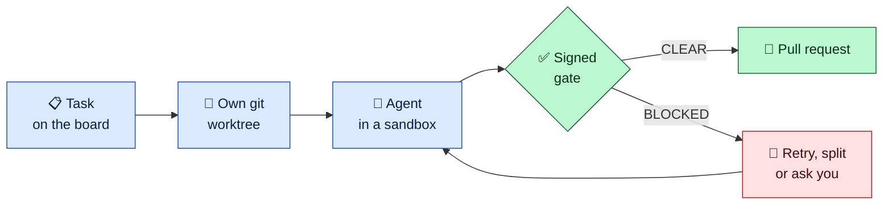
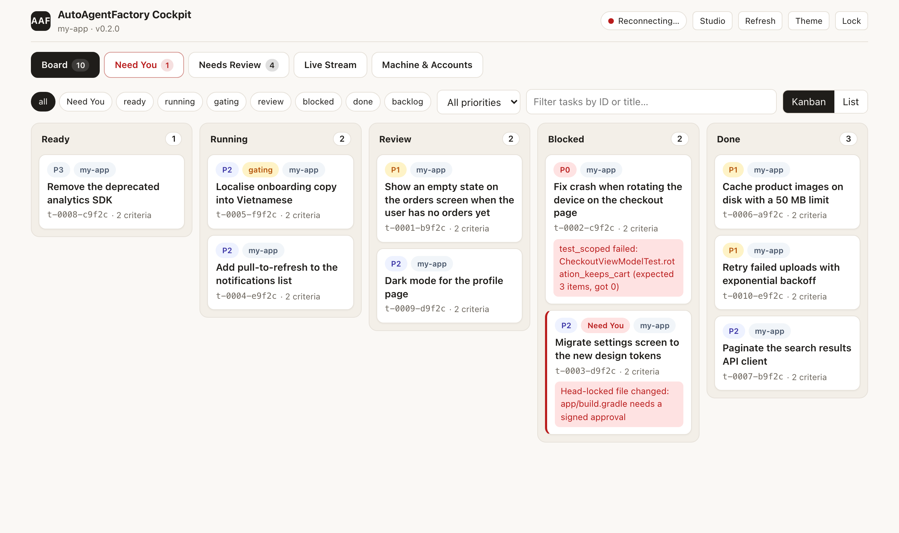

<div align="center">

# 🏭 AutoAgentFactory

**Let AI coding agents work through your task board — safely, verifiably, and without freezing your machine.**

[](https://github.com/ToanMobile/AutoAgentFactory/actions/workflows/ci.yml)
[](https://github.com/ToanMobile/AutoAgentFactory/tags)


[](LICENSE)

English · [Tiếng Việt](docs/README.vi.md) · [Quickstart](docs/QUICKSTART.md) · [Full guide](docs/GUIDE.md)

</div>

---

`aaf` is one Rust binary (plus a small guard, `aaf-hook`) that turns
*"let an agent work on my repo"* into a repeatable pipeline. The agent never
decides when it is done: a gate running **outside** the sandbox does, and only a
signed `CLEAR` receipt lets the work through.



## ✨ Why use it

| 😬 Without aaf | 🛡️ With aaf |
|---|---|
| The agent says "done" but the build is red | Work is accepted only when `aaf gate` writes a **signed receipt** for that exact tree |
| The agent "fixes" a failing test by editing the test | Tests, CI and manifests are **head-locked**: changes need your sign-off |
| The agent fakes a green result | Receipts are HMAC-signed with a key the agent **cannot read** |
| Five agents start Gradle at once and the Mac freezes | One **machine-wide queue** for heavy builds that watches memory and CPU |
| The agent force-pushes or deletes `.env` | `aaf-hook` **blocks dangerous tool calls** before they run |
| You lose track of what ran, how long, and what it cost | **Studio** shows every number on one page |

Works with **Claude Code, Codex, Gemini, Antigravity and OpenCode**.

## 🚀 Get started in 3 steps

```sh
# 1. Install aaf and aaf-hook (macOS / Linux, SHA-256 verified, falls back to a source build)
curl -fsSL https://raw.githubusercontent.com/ToanMobile/AutoAgentFactory/main/scripts/install.sh | sh

# 2. Set up your repo: detects your agents, registers hooks, writes config, runs checks
cd ~/code/my-app
aaf setup

# 3. Add a task and let the factory run it
aaf board add --title "Empty state on orders screen" \
  --spec "Show an illustration and a 'Browse products' button when there are no orders." \
  --accept "Empty list shows the empty state"
aaf run
```

> 💡 Commit the files `aaf setup` registers (it prints the exact `git add … && git commit` line):
> agents work from commits, so an uncommitted hook means no agent run.
> If your test commands are not detected, fill in `[commands]` in `.autofactory/config.toml`.

<details>
<summary>Other install options: Homebrew, from source</summary>

```sh
brew install --formula packaging/homebrew/aaf.rb      # Homebrew
cargo install --path crates/aaf-cli  --locked         # from source: aaf
cargo install --path crates/aaf-hook --locked         # from source: aaf-hook
```

Keep both `aaf` and `aaf-hook` on your `PATH`. Details: [Quickstart](docs/QUICKSTART.md).

</details>

> **Requirements:** macOS or Linux, git ≥ 2.34, and at least one agent CLI
> (for example `claude`) logged in. `gh` is optional, for pull requests.
> On Linux, agents run without a sandbox for now (`aaf run --unsandboxed`).

## 🖥️ Cockpit: your Kanban board

```sh
aaf ui --open        # opens the Cockpit on the Kanban board
```



`aaf ui` opens on a **Kanban board**: Ready → Running → Review → Blocked → Done.
Click a card for its runs, events and handover; switch to **List** any time.
The **Need You** tab, approvals, live agent logs and accounts are one click away.

**📊 Studio** (`/studio`, the *Studio* button) is the optional statistics screen:
KPIs, time per stage, cost per agent, why tasks block and health checks.
The same report is in the terminal with `aaf report --since 24`.

<details>
<summary>Studio screenshots</summary>


</details>

<sub>Screenshots use demo data.</sub>

## 🧰 Everyday commands

| I want to… | Command |
|---|---|
| Set up a repo | `aaf setup` |
| Check the machine and repo | `aaf doctor` |
| Add a task | `aaf board add --title … --spec … --accept …` |
| See the board | `aaf board list` · `aaf board show <id>` |
| Run the agents | `aaf run` (once) · `aaf run --auto` (keep going) |
| Watch live | `aaf watch` · `aaf ui --open` |
| Run the checks myself | `aaf gate` |
| See metrics | `aaf report` · `aaf status` |
| Unblock a task | `aaf board unblock <id>` |
| Approve a locked change | `aaf approve --reviewer <name>` |
| Run a heavy build politely | `aaf slot -- ./gradlew test` |

Add `--json` to any command for machine-readable output
(exit `0` ok, `1` error, `2` blocked). `aaf <command> --help` explains each one.

<details>
<summary>Everything else in the box</summary>

| | Feature | Command |
|---|---|---|
| 👥 | Multi-account scheduling with rate-limit cooldowns | `aaf accounts` |
| 📸 | Signed device-screenshot proofs | `aaf proof` |
| 🧭 | Declarative SOP workflows | `aaf sop` |
| 🔌 | 10 agent CLIs with fallback routing | `aaf executors` |
| 📝 | Acceptance handover report (Markdown / HTML / JSON) | `aaf handover` |
| 🖥️ | Interactive terminal cockpit | `aaf cockpit` |
| 📱 | Telegram companion and "needs you" pushes | `aaf telegram` · `aaf notify` |
| 🧹 | Clean up old worktrees and logs | `aaf gc` |
| ⬆️ | Self-update | `aaf upgrade` |

</details>

## 📚 Learn more

| Document | What is inside |
|---|---|
| [Quickstart](docs/QUICKSTART.md) | Install options (Homebrew, Docker, from source) and a first run |
| [Full guide](docs/GUIDE.md) | Every command, the configuration, the safety model, heavy builds, FAQ |
| [Architecture](docs/ARCHITECTURE.md) | Crates, modules, the life of a task, dependency rules |
| [Security](SECURITY.md) | Threat model and every guard rule |
| [Hướng dẫn tiếng Việt](docs/README.vi.md) | Vietnamese guide and verification status |

## 🤝 Contributing

```sh
cargo fmt --all --check
cargo clippy --workspace --all-targets -- -D warnings
cargo test --workspace
```

These are the same checks CI runs. House rules are in
[docs/ARCHITECTURE.md](docs/ARCHITECTURE.md#6-house-rules).

## 📄 License

Apache-2.0. See [LICENSE](LICENSE).
