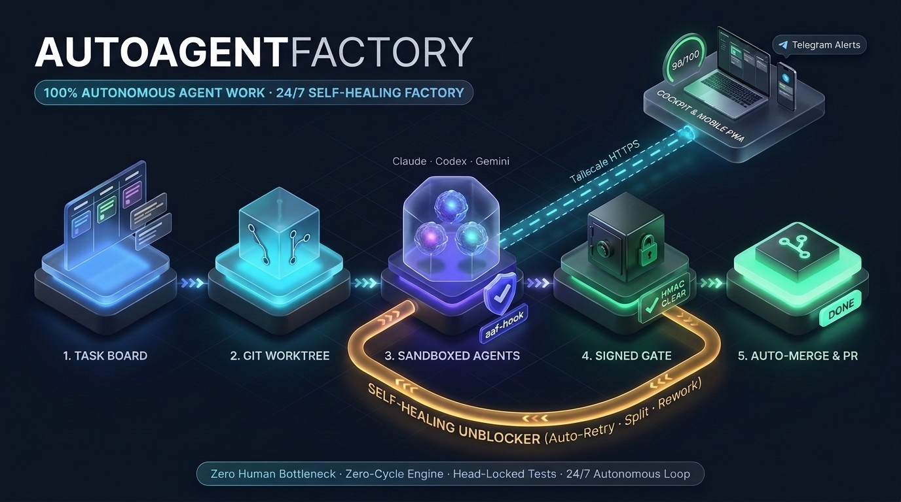
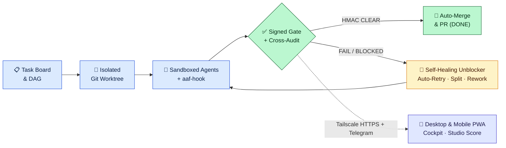
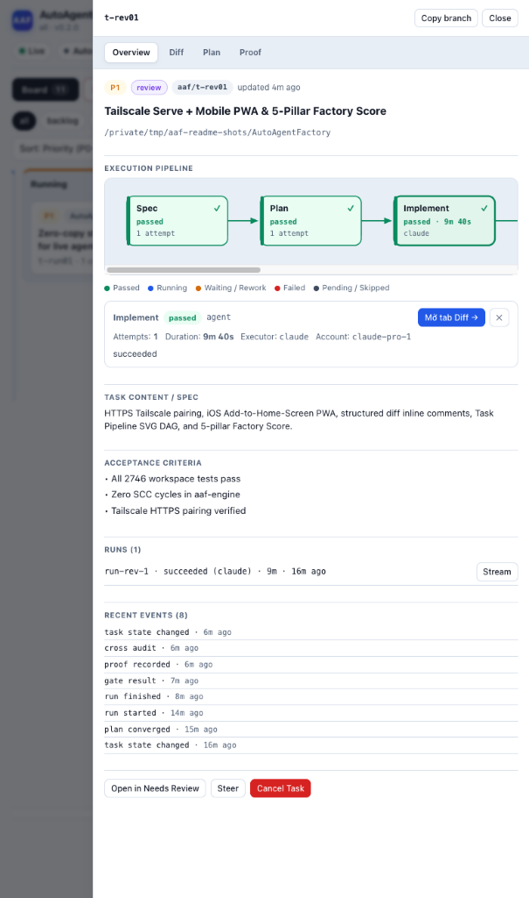
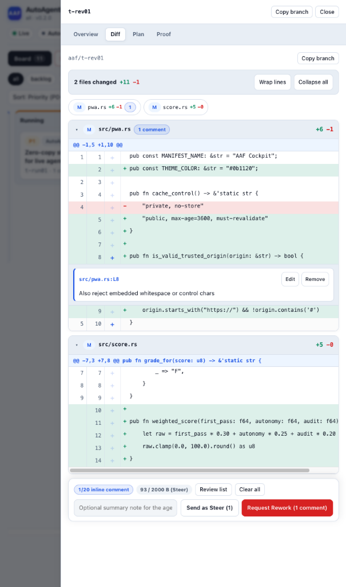
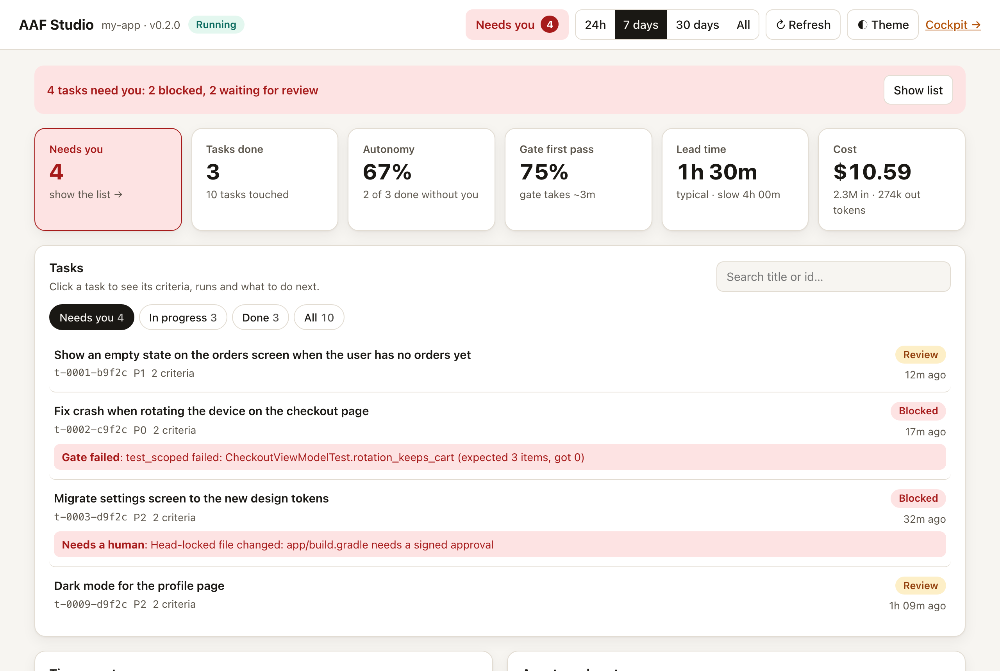
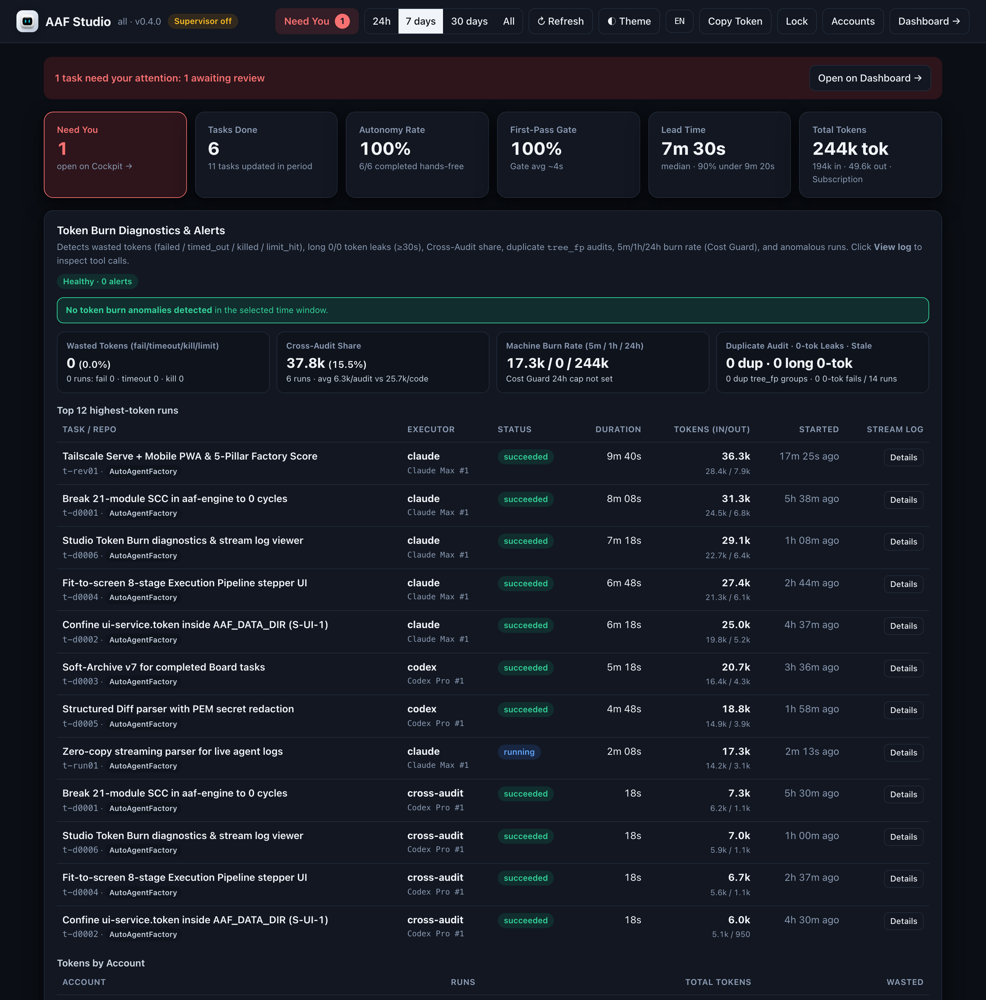
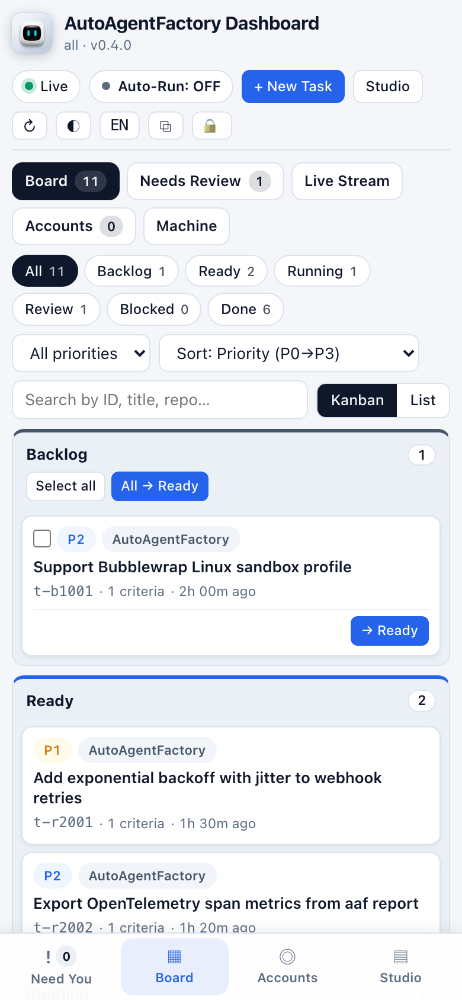
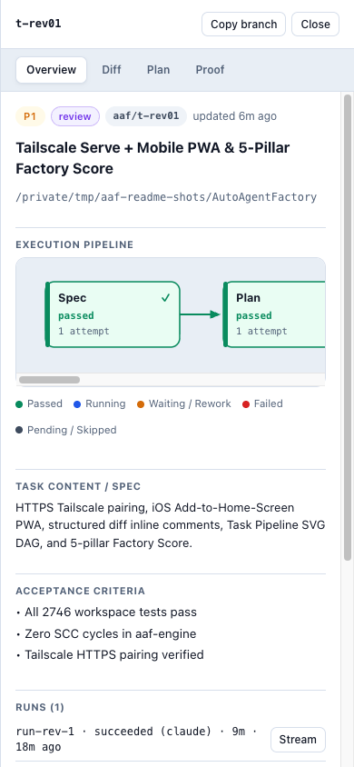

<div align="center">

# 🏭 AutoAgentFactory

**100% Autonomous Agent Work — let AI coding agents plan, code, verify, self-heal, and ship PRs 24/7 without freezing your machine.**

[](https://github.com/ToanMobile/AutoAgentFactory/actions/workflows/ci.yml)
[](https://github.com/ToanMobile/AutoAgentFactory/tags)


[](LICENSE)

English · [Tiếng Việt](docs/README.vi.md) · [Quickstart](docs/QUICKSTART.md) · [Full guide](docs/GUIDE.md) · [Architecture](docs/ARCHITECTURE.md)

<br />



</div>

---

`aaf` is a single Rust binary (plus a tiny tool guard, `aaf-hook`) that turns *"let an agent work on my repo"* into a **100% autonomous, 24/7 self-healing production loop**. Agents never declare themselves done: every change is built inside an isolated git worktree + sandbox, verified **outside** the sandbox by a cryptographically signed `aaf gate`, cross-audited, and automatically retried, split, or shipped as a PR — while you monitor or steer from Desktop or iPhone PWA only when you actually want to.

### ⚡ How the 100% Autonomous Loop Works

1. **Task Board & DAG (`aaf board`):** Queue tasks with dependencies, priorities, and acceptance criteria; run `aaf run --auto --auto-merge --auto-split` for hands-off 24/7 execution.
2. **Isolated Git Worktree:** Every task runs in its own clean worktree (`aaf/<task-id>`) with zero cross-task pollution and automatic post-merge cleanup (`aaf gc`).
3. **Sandboxed Multi-Agent Workers (`Claude · Codex · Gemini · Antigravity · OpenCode`):** Agents run inside OS confinement (macOS Seatbelt) guarded by `aaf-hook`, with multi-account cooldown scheduling and a machine-wide heavy-build throttle (`aaf slot`).
4. **Signed Gate + Proof + Dual Cross-Audit:** `aaf gate` runs outside the sandbox over head-locked tests/CI and writes an HMAC-signed `CLEAR` receipt using a key agents cannot read.
5. **Self-Healing Unblocker & Auto-Merge:** When a gate fails, the Unblocker automatically retries, splits oversized tasks, or escalates executors before ever bothering a human — then auto-merges or opens a clean PR and exports an acceptance handover report.

<details>
<summary>Compact Mermaid flow reference</summary>



</details>

## ✨ Why use it

| 😬 Without `aaf` | 🛡️ With `aaf` (100% Autonomous Factory) |
|---|---|
| The agent says "done" but the build is red | Work passes **only** when `aaf gate` writes a **signed `CLEAR` receipt** for that exact git tree |
| The agent "fixes" a failing test by deleting assertions | Tests, CI, and manifests are **head-locked**; edits require explicit human sign-off (`aaf approve`) |
| The agent fakes a green receipt or reads your secrets | Receipts & UI tokens live in `AAF_DATA_DIR`, **read-denied** by OS sandbox + `aaf-hook` |
| Five agents launch Gradle/Cargo at once and freeze your Mac | One **machine-wide heavy-build queue** (`aaf slot`) tracking peak RAM & CPU pressure |
| One stuck task stalls the whole queue overnight | **Self-Healing Unblocker** auto-retries, splits subtasks, rotates cooled-down accounts, and keeps shipping |
| You have to stay at your desk to inspect diffs or steer | **Tailscale HTTPS Mobile PWA + Telegram Deep-Links** let you review inline diffs & scores from iPhone |

Works out of the box with **Claude Code, Codex CLI, Gemini CLI, Antigravity, and OpenCode**.

## 🚀 Get started in 3 steps

```sh
# 1. Install aaf and aaf-hook (macOS / Linux, SHA-256 verified, falls back to a source build)
curl -fsSL https://raw.githubusercontent.com/ToanMobile/AutoAgentFactory/main/scripts/install.sh | sh

# 2. Set up your repo: detects your agents, registers hooks, writes config, runs checks
cd ~/code/my-app
aaf setup

# 3. Queue tasks and let the autonomous factory run 24/7
aaf board add --title "Empty state on orders screen" \
  --spec "Show an illustration and a 'Browse products' button when there are no orders." \
  --accept "Empty list shows the empty state"
aaf run --auto
```

> 💡 Commit the files `aaf setup` registers (it prints the exact `git add … && git commit` line):
> agents work from commits, so an uncommitted hook means no agent run.
> If your test commands are not detected, fill in `[commands]` in `.autofactory/config.toml`.

<details>
<summary>Other install options: Homebrew, from source</summary>

```sh
brew install --formula packaging/homebrew/aaf.rb      # Homebrew
cargo install --path crates/aaf-cli  --locked         # from source: aaf
cargo install --path crates/aaf-hook --locked         # from source: aaf-hook
```

Keep both `aaf` and `aaf-hook` on your `PATH`. Details: [Quickstart](docs/QUICKSTART.md).

</details>

> **Requirements:** macOS or Linux, git ≥ 2.34, and at least one agent CLI
> (for example `claude`) logged in. `gh` is optional, for pull requests.
> On Linux, `aaf run` sandboxes agents with Bubblewrap (`bwrap`) or an active hardened container; pass `--unsandboxed` only when no isolation layer is available.

## 🖥️ Desktop & 📱 Mobile PWA Dashboard

Zero external CDN dependencies, loopback-bound (`127.0.0.1`), Bearer-token authenticated (`AAF_DATA_DIR/ui-service.token`), with one-command **Tailscale Serve HTTPS + iPhone Add-to-Home-Screen PWA + Telegram `?task=<id>` Deep-Links**:

```sh
# Local desktop dashboard
aaf ui --open

# Always-on background service + Tailscale HTTPS + QR pairing for iPhone PWA
aaf ui --install-service --allow-actions --tailscale --qr
```

### Desktop — Cockpit Kanban Board

Live SSE-synced board across `Backlog → Ready → Running → Gating → Review → Blocked → Done`, with one-click **Auto-Run** toggle, **Need You** triage, live agent stream, accounts, and SOP workflow runs.


### Desktop — 8-Stage Execution Pipeline DAG & Structured Inline Diff Review

Inspect every task's deterministic `Spec → Plan → Implement → Gate → Proof → Audit → Review → Done` SVG DAG, then review structured diffs with `head_locked` badges, secret redaction, and **inline line-level review comments** (`Send as Steer` or `Request Rework`).

<table>
  <tr>
    <th width="50%">🧭 Task Execution Pipeline (SVG DAG)</th>
    <th width="50%">🔍 Structured Diff & Inline Line Review</th>
  </tr>
  <tr>
    <td></td>
    <td></td>
  </tr>
</table>

### Desktop — AAF Studio & 5-Pillar Factory Score (Light & Dark)

Deterministic **Post-Run Factory Score (0–100, Grade A–F)** combining First-Pass Gate (`30%`), Autonomy Discipline (`25%`), Cross-Audit Integrity (`20%`), Block Health (`15%`), and Flow Efficiency (`10%`) — plus automatic **Top-3 Bottlenecks** and per-task token/latency breakdowns.

<table>
  <tr>
    <th width="50%">☀️ Studio — Factory Score (Light)</th>
    <th width="50%">🌙 Studio — Factory Score (Dark)</th>
  </tr>
  <tr>
    <td></td>
    <td></td>
  </tr>
</table>

### Mobile — iPhone PWA via Tailscale Serve + Telegram Deep-Links

Scan the `--qr` code from your Mac, tap **Share → Add to Home Screen** on iPhone, and check **Remember on this device**. Background tabs automatically pause SSE to save battery, and Telegram alerts (`aaf notify`) link directly to `https://<your-mac>.ts.net/?task=<id>` without ever putting tokens in chat messages.

<div align="center">
<table>
  <tr>
    <th>📱 Mobile Cockpit PWA (Bottom Nav)</th>
    <th>📱 Mobile Task Pipeline & Deep-Link</th>
  </tr>
  <tr>
    <td align="center"></td>
    <td align="center"></td>
  </tr>
</table>
</div>

<sub>Screenshots use live demo data captured directly from `aaf ui --service --allow-actions` on Desktop (1440×900) and iPhone PWA (390×844).</sub>

## 🧰 Everyday commands

| I want to… | Command |
|---|---|
| Set up a repo | `aaf setup` |
| Check the machine and repo | `aaf doctor` |
| Add a task | `aaf board add --title … --spec … --accept …` |
| See the board | `aaf board list` · `aaf board show <id>` |
| Run agents 100% autonomously | `aaf run --auto` · `aaf run --auto --auto-merge --auto-split` |
| Open Desktop Cockpit & Studio | `aaf ui --open` |
| Pair iPhone PWA over Tailscale HTTPS | `aaf ui --install-service --allow-actions --tailscale --qr` |
| Watch live in terminal | `aaf watch` · `aaf cockpit` |
| Run the signed gate myself | `aaf gate` |
| See metrics, Factory Score & lessons | `aaf report --since 168` · `aaf report --lessons` · `aaf status` |
| Steer or rework a task | `aaf board steer <id> --note "…"` · `aaf board rework <id>` |
| Unblock a task | `aaf board unblock <id>` |
| Approve a head-locked change | `aaf approve --reviewer <name>` |
| Run a heavy build politely | `aaf slot -- ./gradlew test` |

Add `--json` to any command for machine-readable output
(exit `0` ok, `1` error, `2` blocked). `aaf <command> --help` explains each one.

<details>
<summary>Everything else in the box</summary>

| | Feature | Command |
|---|---|---|
| 👥 | Multi-account scheduling with rate-limit cooldowns | `aaf accounts` |
| 📸 | Signed device-screenshot proofs | `aaf proof` |
| 🧭 | Declarative SOP workflows with crash-safe checkpoints | `aaf sop` |
| 🔌 | 10 agent CLIs with fallback routing | `aaf executors` |
| 📝 | DevKit acceptance handover report (auto-exported to `reports/` on completion) | `aaf handover` |
| 📱 | Telegram companion & deep-linked "needs you" alerts | `aaf telegram` · `aaf notify` |
| 🧹 | Clean up old worktrees, snapshots, and merged `aaf/*` branches | `aaf gc` |
| ⬆️ | Self-update | `aaf upgrade` |

</details>

## 📚 Learn more

| Document | What is inside |
|---|---|
| [Quickstart](docs/QUICKSTART.md) | Install options (Homebrew, Docker, from source) and a first run |
| [Full guide](docs/GUIDE.md) | Every command, the configuration, the safety model, heavy builds, FAQ |
| [Architecture](docs/ARCHITECTURE.md) | 5 crates, 0-cycle `aaf-engine` module graph (Tarjan SCC ratchet), task lifecycle |
| [Security](SECURITY.md) | Threat model, token confinement (`S-UI-1`), and every guard rule |
| [Hướng dẫn tiếng Việt](docs/README.vi.md) | Vietnamese guide and verification status |

## 🤝 Contributing

```sh
cargo fmt --all --check
cargo clippy --workspace --all-targets -- -D warnings
cargo test --workspace
```

These are the same checks CI runs. House rules (`<= 600` lines/file, 0 `tokio`, 0 `unsafe` outside sandbox check, 0 SCC cycles in `aaf-engine`) are enforced as tests in [docs/ARCHITECTURE.md](docs/ARCHITECTURE.md#6-house-rules).

## 📄 License

Apache-2.0. See [LICENSE](LICENSE).
